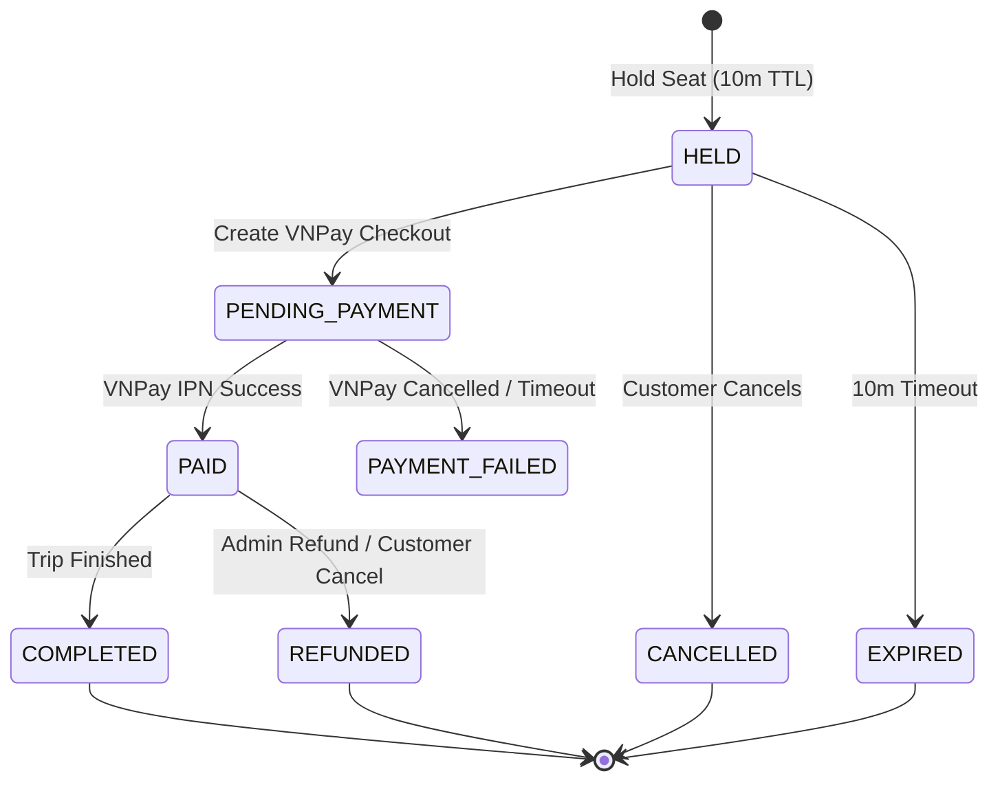

# ⚙️ VeloBus Backend — High-Concurrency Distributed Core

<p align="center">
  🌐 <b><a href="README.md">English</a></b> | <b><a href="README.vi.md">Tiếng Việt</a></b>
</p>

[](https://openjdk.org/)
[](https://spring.io/)
[](https://www.mysql.com/)
[](https://redis.io/)
[](https://redisson.org/)
[](https://maven.apache.org/)
[]()

The core backend of the **VeloBus** platform, architected as a **Micro-Modular Monolith** using **Domain-Driven Design (DDD)** and **Clean / Hexagonal Architecture**. Engineered on **Java 21** and **Spring Boot 3.4.1**, the system delivers ultra-high throughput with Java 21 Virtual Threads, distributed concurrency safety via Redisson, sub-20ms catalog cache hit response times, and multi-tenant bus operator escrow settlement.

---

## 🏛️ Architecture & Bounded Contexts

The backend is decomposed into **8 Bounded Contexts** spanning **33 Maven Modules**, strictly enforcing isolation across domain boundaries.

```
backend/
├── shared-kernel/                         # Core Value Objects, Exceptions, Common DTOs
├── context-identity/                      # JWT Auth, RBAC, User & Admin Management
│   ├── identity-domain/                   # Pure Domain Models & Outbound Ports
│   ├── identity-application/              # Registration, Login, Token UseCases
│   ├── identity-infrastructure/           # JPA Entities, Spring Security Adapters
│   └── identity-presentation/             # REST Endpoints (/api/v1/auth, /api/v1/admin/users)
├── context-catalog/                       # Stations, Routes, Trips, Seat Matrices & Caching
│   ├── catalog-domain/
│   ├── catalog-application/
│   ├── catalog-infrastructure/
│   └── catalog-presentation/             # (/api/v1/catalog, /api/v1/admin/trips)
├── context-booking/                       # Redisson Seat Locks, Booking FSM & Lifecycle
│   ├── booking-domain/
│   ├── booking-application/
│   ├── booking-infrastructure/
│   └── booking-presentation/             # (/api/v1/bookings, /api/v1/admin/bookings)
├── context-payment/                       # VNPay HMAC-SHA512 Gateway & IPN Idempotency
│   ├── payment-domain/
│   ├── payment-application/
│   ├── payment-infrastructure/
│   └── payment-presentation/             # (/api/v1/payments, /api/v1/admin/payments)
├── context-notification/                  # Telegram Bot, Push Notifications, Firebase Storage
│   ├── notification-domain/
│   ├── notification-application/
│   ├── notification-infrastructure/
│   └── notification-presentation/         # (/api/v1/notifications, /api/v1/public/upload)
├── context-partner/                       # Bus Operators, Fleet & Driver Roster, Escrow Wallet
│   ├── partner-domain/
│   ├── partner-application/
│   ├── partner-infrastructure/
│   └── partner-presentation/             # (/api/v1/partners, /api/v1/admin/partners)
└── ticket-start/                          # Application Entry Point & Spring Boot Packaging
```

---

## 🔒 Concurrency & Distributed Invariants

### 1. Two-Tier Seat Locking (Redisson + Database Constraint)
To guarantee **Zero Overbooking** during high-demand booking spikes (flash sales, holiday rush):
1. **Tier 1 (Redis Distributed Lock):** Redisson fair lock is acquired on `lock:trip:{tripId}:seat:{seatCode}` with lease TTL = 10 minutes.
2. **Tier 2 (Database Defense-in-Depth):** The MySQL `booking_seats` table enforces a composite unique key:
   ```sql
   UNIQUE KEY `uk_trip_seat_status` (`trip_id`, `seat_code`, `status_active`)
   ```
   If Redis fails or partitions, the database rejects concurrent writes with `DuplicateKeyException`, triggering an automated rollback.

### 2. Turnaround Buffer (30 Minutes)
Between successive trips assigned to the same vehicle or driver, the `PartnerCommandService` enforces an immutable 30-minute maintenance and turnaround buffer to prevent driver fatigue and vehicle scheduling collisions.

### 3. Fail-Closed Security & Tenant Isolation
- **Tenant Isolation:** Operator fleet and wallet queries strictly enforce `findByIdAndOperatorId(id, operator.getId())`, making cross-tenant data manipulation (IDOR) impossible.
- **Fail-Closed Admin Identity:** All administrative actions (KYC approval, withdrawal disbursements, suspensions) resolve the authenticated `Principal` securely without fallback defaults, maintaining strict audit logging.

---

## 🔄 Booking Lifecycle State Machine (FSM)



---

## 💳 Fintech Escrow Wallet Architecture

Each approved Bus Operator possesses an Escrow Ledger partitioned into 4 distinct balances:
- `AVAILABLE`: Liquid balance ready for instant withdrawal request.
- `HOLDING_ESCROW`: Funds held in trust for passengers on trips currently in-flight.
- `SETTLING`: T+1 banking clearance and gateway settlement.
- `WITHDRAWN`: Total historical disbursements.

---

## 🧪 Testing & Quality Assurance

The backend repository contains **209 Unit & Integration Tests** executed via JUnit 5, Mockito, and Testcontainers:

```bash
# Execute the entire Maven test suite across all 33 modules
mvn clean test

# Execute build packaging skipping tests
mvn clean package -DskipTests
```

---

## 🚀 Local Development Setup

### Prerequisites
- **JDK 21** (Eclipse Temurin recommended)
- **Maven 3.9+**
- **Docker & Docker Compose** (for MySQL & Redis)

### Step-by-Step
```bash
# 1. Start dependent services (MySQL 8.4 on 3307, Redis 7.2 on 6379)
docker compose up -d ticket-mysql ticket-redis

# 2. Navigate to backend directory
cd backend

# 3. Compile and launch Spring Boot application
mvn spring-boot:run -pl ticket-start
```

The application will bind to `http://localhost:8080`. API documentation and OpenAPI contracts are available at `http://localhost:8080/swagger-ui.html`.
