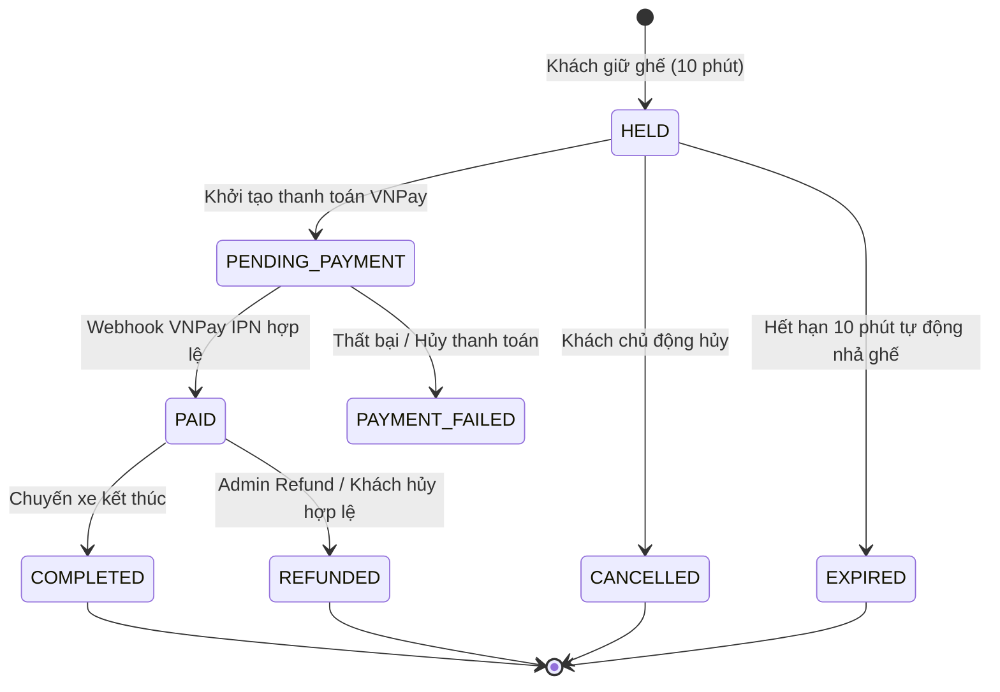

# ⚙️ VeloBus Backend — Lõi Phân Tán Xử Lý Đồng Thời Cao

<p align="center">
  🌐 <b><a href="README.md">English</a></b> | <b><a href="README.vi.md">Tiếng Việt</a></b>
</p>

[](https://openjdk.org/)
[](https://spring.io/)
[](https://www.mysql.com/)
[](https://redis.io/)
[](https://redisson.org/)
[](https://maven.apache.org/)
[]()

Hệ thống lõi backend của nền tảng **VeloBus**, được thiết kế theo mô hình **Micro-Modular Monolith** kết hợp **Thiết kế hướng miền (Domain-Driven Design - DDD)** và **Kiến trúc Lục giác (Clean / Hexagonal Architecture)** trên nền tảng **Java 21** và **Spring Boot 3.4.1**. Nền tảng được tối ưu hóa cho thông lượng cực lớn với Java 21 Virtual Threads, an toàn tương tranh phân tán thông qua Redisson, tra cứu danh mục dưới 20ms và quyết toán ký quỹ tự động cho các đối tác nhà xe.

---

## 🏛️ Kiến Trúc & Các Bounded Contexts

Toàn bộ Backend được chia thành **8 Bounded Contexts** trải rộng trên **33 Maven Modules**, bảo đảm tính đóng gói và độc lập giữa các miền nghiệp vụ:

```
backend/
├── shared-kernel/                         # Đối tượng giá trị dùng chung, Ngoại lệ lõi, DTO dùng chung
├── context-identity/                      # Xác thực JWT, Phân quyền RBAC, Quản trị người dùng
│   ├── identity-domain/                   # Mô hình miền thuần khiết (Pure Java) & Outbound Ports
│   ├── identity-application/              # UseCases đăng ký, đăng nhập, cấp phát token
│   ├── identity-infrastructure/           # JPA Entities, Spring Security Adapters
│   └── identity-presentation/             # REST Endpoints (/api/v1/auth, /api/v1/admin/users)
├── context-catalog/                       # Bến xe, Tuyến đường, Chuyến xe, Ma trận ghế & Cache Redis
│   ├── catalog-domain/
│   ├── catalog-application/
│   ├── catalog-infrastructure/
│   └── catalog-presentation/             # (/api/v1/catalog, /api/v1/admin/trips)
├── context-booking/                       # Khóa ghế Redisson, FSM Vòng đời đơn đặt vé
│   ├── booking-domain/
│   ├── booking-application/
│   ├── booking-infrastructure/
│   └── booking-presentation/             # (/api/v1/bookings, /api/v1/admin/bookings)
├── context-payment/                       # Cổng thanh toán VNPay HMAC-SHA512 & Đối soát IPN Idempotent
│   ├── payment-domain/
│   ├── payment-application/
│   ├── payment-infrastructure/
│   └── payment-presentation/             # (/api/v1/payments, /api/v1/admin/payments)
├── context-notification/                  # Bot Telegram, Thông báo đẩy FCM, Lưu trữ Firebase
│   ├── notification-domain/
│   ├── notification-application/
│   ├── notification-infrastructure/
│   └── notification-presentation/         # (/api/v1/notifications, /api/v1/public/upload)
├── context-partner/                       # Nhà xe đối tác, Quản lý đội xe, Ví ký quỹ (Escrow)
│   ├── partner-domain/
│   ├── partner-application/
│   ├── partner-infrastructure/
│   └── partner-presentation/             # (/api/v1/partners, /api/v1/admin/partners)
└── ticket-start/                          # Điểm khởi động ứng dụng & Đóng gói Spring Boot Runnable JAR
```

---

## 🔒 Kiểm Soát Đồng Thời & Bất Biến Phân Tán

### 1. Khóa Giữ Ghế 2 Lớp (Redisson + Database Constraint)
Nhằm cam kết **Zero Overbooking** (tuyệt đối không trùng ghế) trong các đợt mở bán vé cao điểm:
1. **Lớp 1 (Redis Distributed Lock):** Redisson Fair Lock phân tán được xác lập trên khóa `lock:trip:{tripId}:seat:{seatCode}` với thời hạn giữ chỗ TTL = 10 phút.
2. **Lớp 2 (Phòng thủ đa tầng Database):** Bảng `booking_seats` trong MySQL thiết lập ràng buộc khóa duy nhất:
   ```sql
   UNIQUE KEY `uk_trip_seat_status` (`trip_id`, `seat_code`, `status_active`)
   ```
   Nếu Redis gặp sự cố phân mảnh mạng, Database Transaction sẽ chặn đứng thao tác ghi đè bằng `DuplicateKeyException` và tự động rollback.

### 2. Quy Chuẩn Turnaround Buffer (30 Phút)
Giữa hai chuyến xe kế tiếp của cùng một phương tiện hoặc tài xế, `PartnerCommandService` bắt buộc duy trì khoảng đệm 30 phút để kiểm tra kỹ thuật phương tiện và thời gian nghỉ của lái xe, nghiêm cấm lập trùng lịch.

### 3. Bảo Mật Fail-Closed & Cô Lập Dữ Liệu Nhà Xe (Tenant Isolation)
- **Tenant Isolation:** Toàn bộ truy vấn đội xe, tài xế, số dư ví đều bắt buộc qua phương thức `findByIdAndOperatorId(id, operator.getId())`, vô hiệu hóa hoàn toàn nguy cơ tấn công IDOR.
- **Fail-Closed Admin Identity:** Các thao tác phê duyệt giải ngân, khóa tài khoản hoặc điều chỉnh chiết khấu sàn yêu cầu phân giải danh tính rõ ràng từ `Principal`, ném lỗi `ForbiddenException` ngay lập tức nếu không hợp lệ để đảm bảo tính toàn vẹn của Audit Trail.

---

## 🔄 Máy Trạng Thái Đơn Vé (Booking FSM)



---

## 💳 Kiến Trúc Ví Ký Quỹ Đối Tác (Fintech Escrow Wallet)

Mỗi đối tác nhà xe được phân chia thành 4 phân vùng số dư tài khoản độc lập:
- `AVAILABLE`: Số dư khả dụng, sẵn sàng thực hiện lệnh rút tiền 24/7.
- `HOLDING_ESCROW`: Tiền tạm giữ an toàn của các chuyến xe đang lăn bánh.
- `SETTLING`: Đang quyết toán qua cổng ngân hàng (Chu kỳ T+1).
- `WITHDRAWN`: Tổng số tiền đã giải ngân thành công qua tài khoản ngân hàng thụ hưởng.

---

## 🧪 Kiểm Thử & Đảm Bảo Chất Lượng

Hệ thống sở hữu **209 bài kiểm thử Unit & Integration Tests** sử dụng JUnit 5, Mockito và Testcontainers:

```bash
# Chạy toàn bộ test suite trên toàn bộ 33 modules
mvn clean test

# Đóng gói ứng dụng bỏ qua kiểm thử
mvn clean package -DskipTests
```

---

## 🚀 Hướng Dẫn Khởi Chạy Local

### Yêu Cầu Cài Đặt
- **JDK 21** (Khuyến nghị Eclipse Temurin)
- **Maven 3.9+**
- **Docker & Docker Compose** (Dành cho MySQL & Redis)

### Các Bước Thực Hiện
```bash
# 1. Khởi động MySQL 8.4 (Port 3307) và Redis 7.2 (Port 6379)
docker compose up -d ticket-mysql ticket-redis

# 2. Di chuyển vào thư mục backend
cd backend

# 3. Biên dịch và khởi chạy ứng dụng Spring Boot
mvn spring-boot:run -pl ticket-start
```

Ứng dụng sẽ hoạt động tại địa chỉ `http://localhost:8080`. Tài liệu API Swagger/OpenAPI có sẵn tại `http://localhost:8080/swagger-ui.html`.
