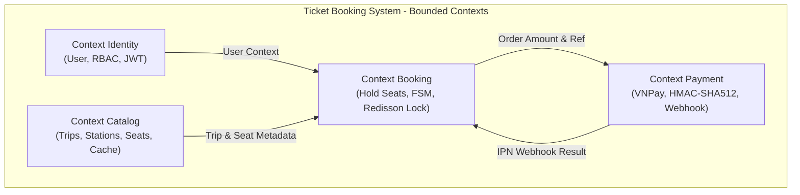

# 01.1. Tổng Quan & Phạm Vi Nghiệp Vụ Hệ Thống

## 1. Bài Toán Cốt Lõi
Hệ thống **Ticket Booking Platform** được xây dựng nhằm giải quyết bài toán giao dịch bán vé trực tuyến (máy bay, tàu hỏa, xe khách) với các thách thức kỹ thuật trọng yếu:
- **Xử lý đồng thời cao (High Concurrency):** Vào các khung giờ mở bán vé tết hoặc flash-sale, hàng chục nghìn người cùng truy cập và chọn ghế tại cùng một thời điểm.
- **Ngăn chặn tuyệt đối bán vượt số lượng vé (Zero Overbooking / Race Condition):** Tuyệt đối không cho phép 2 khách hàng mua trùng một vị trí ghế.
- **Tra cứu lịch trình với độ trễ cực thấp (< 20ms):** Giảm thiểu 90% tải truy vấn lên MySQL thông qua bộ nhớ đệm phân tán.
- **Tích hợp thanh toán an toàn & Idempotent:** Bảo vệ giao dịch tài chính với chữ ký số HMAC-SHA512 và cơ chế chống xử lý trùng lặp giao dịch.

---

## 2. Ranh Giới 4 Bounded Contexts

---

## 3. Phân Cấp Đối Tượng Sử Dụng (Actors & RBAC Scope)
Hệ thống thiết kế theo mô hình **Role-Based Access Control (RBAC)** với 3 nhóm tác nhân chính:

1. **Khách vãng lai (Guest / Anonymous):**
   - Chỉ được phép tra cứu thông tin công khai: Xem danh sách chuyến đi, xem sơ đồ và trạng thái chỗ ngồi, xem thông tin ga/bến.
   - Không được phép thực hiện hành động giữ chỗ, đặt vé hay can thiệp hệ thống.
   - Được phép đăng ký tài khoản mới và đăng nhập.

2. **Khách hàng (`ROLE_CUSTOMER`):**
   - Kế thừa toàn bộ khả năng tra cứu của Guest.
   - Được phép thực hiện đặt vé: Giữ ghế tạm thời (Hold seat 10 phút với Distributed Lock), hủy đơn giữ chỗ của chính mình.
   - Được phép thanh toán trực tuyến qua cổng VNPay, nhận vé điện tử, xem lịch sử đặt chỗ của tài khoản mình.

3. **Quản trị viên (`ROLE_ADMIN`):**
   - Quản trị tuyến đường và chuyến đi (Thêm, sửa, xóa, vô hiệu hóa chuyến đi).
   - Quản trị sơ đồ ghế và cấu hình giá vé theo từng phân hạng.
   - Quản trị đơn vé: Tra cứu toàn bộ đơn đặt vé trong hệ thống, thực hiện hủy vé cưỡng chế hoặc xử lý hoàn tiền thủ công.
   - Đối soát giao dịch tài chính và theo dõi báo cáo doanh thu.

---

## 4. Quy Ước Mã Định Danh (ID Conventions)
Mọi yêu cầu trong tài liệu đều được gắn mã truy vết:
- `REQ-IAM-xx`: Yêu cầu phân hệ Quản lý định danh & Phân quyền.
- `REQ-CAT-xx`: Yêu cầu phân hệ Tra cứu chuyến đi & Sơ đồ ghế.
- `REQ-BKG-xx`: Yêu cầu phân hệ Đặt chỗ & Khóa phân tán.
- `REQ-PAY-xx`: Yêu cầu phân hệ Thanh toán & Đối soát.
