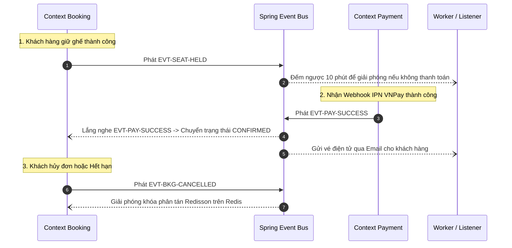

# 02.4. Hệ Thống Sự Kiện Miền (Domain Events)

| Mã Sự Kiện | Tên Sự Kiện Miền | Dữ Liệu Mang Theo (Payload) | Bên Lắng Nghe & Hành Động Kích Hoạt |
| :--- | :--- | :--- | :--- |
| `EVT-SEAT-HELD` | `SeatHeldEvent` | `bookingReference`, `tripId`, `seatNumbers`, `expiresAt` | Khởi chạy bộ đếm thời gian TTL 10 phút |
| `EVT-PAY-SUCCESS` | `PaymentCompletedEvent` | `paymentReference`, `bookingId`, `transactionId`, `amount` | Kích hoạt xác nhận đơn vé `CONFIRMED` |
| `EVT-BKG-CANCELLED` | `BookingCancelledEvent` | `bookingReference`, `tripId`, `seatNumbers` | Gọi Redis nhả khóa phân tán ngay lập tức |
