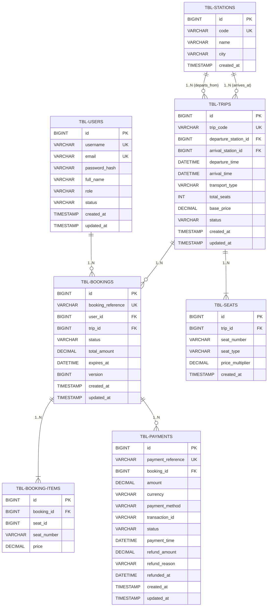

# 03.1. Lược Đồ Cơ Sở Dữ Liệu & ERD (Schema & ERD)

## 1. Sơ Đồ Thực Thể Quan Hệ (ERD Diagram)

---

## 2. Từ Điển Dữ Liệu (Data Dictionary)

### `TBL-USERS`
| Cột | Kiểu | Ràng Buộc | Ý Nghĩa |
| :--- | :--- | :--- | :--- |
| `id` | `BIGINT` | `PK`, `AUTO_INCREMENT` | Khóa chính |
| `username` | `VARCHAR(50)` | `NOT NULL`, `UNIQUE` | Tên đăng nhập |
| `email` | `VARCHAR(100)` | `NOT NULL`, `UNIQUE` | Email |
| `password_hash` | `VARCHAR(255)` | `NOT NULL` | Hash BCrypt |
| `role` | `VARCHAR(20)` | `NOT NULL`, DEFAULT `'ROLE_CUSTOMER'` | Vai trò |
| `status` | `VARCHAR(20)` | `NOT NULL`, DEFAULT `'ACTIVE'` | Trạng thái |

### `TBL-STATIONS`
- **`TBL-STATIONS`**: Lưu danh mục nhà ga, sân bay, bến xe (`id`, `code` UNIQUE 3-10 ký tự, `name`, `city`, `created_at`).

### `TBL-TRIPS`
- **`TBL-TRIPS`**: Lưu thông tin chuyến bay/tàu/xe (`trip_code` UNIQUE, `departure_station_id`, `arrival_station_id`, `departure_time`, `arrival_time`, `transport_type`, `total_seats`, `base_price`, `status` [`SCHEDULED`, `DEPARTED`, `CANCELLED`]).

### `TBL-SEATS`
- **`TBL-SEATS`**: Lưu sơ đồ ghế vật lý của từng chuyến (`trip_id`, `seat_number`, `seat_type` [`STANDARD`, `VIP`], `price_multiplier`).
  - **Ràng buộc:** `UNIQUE KEY uq_trip_seat (trip_id, seat_number)` ngăn chặn việc trùng lặp số ghế trên cùng chuyến đi.

### `TBL-BOOKINGS`
- **`TBL-BOOKINGS`**: Đơn vé với mã tham chiếu `booking_reference` (UUID v4), trạng thái FSM (`status`), mốc hết hạn `expires_at` sau 10 phút, trường khóa lạc quan `version`, và chỉ mục `idx_booking_trip_status_exp (trip_id, status, expires_at)`.

### `TBL-BOOKING-ITEMS`
- **`TBL-BOOKING-ITEMS`**: Lưu từng ghế được giữ trong đơn vé (`booking_id`, `seat_id`, `seat_number`, `price`).

### `TBL-PAYMENTS`
- Bản ghi giao dịch với `payment_reference` (duy nhất), `payment_method` (`VNPAY`), `amount`, `status` (`PENDING`, `SUCCESS`, `FAILED`, `REFUNDED`), cùng thông tin hoàn tiền (`refund_amount`, `refund_reason`, `refunded_at`).
