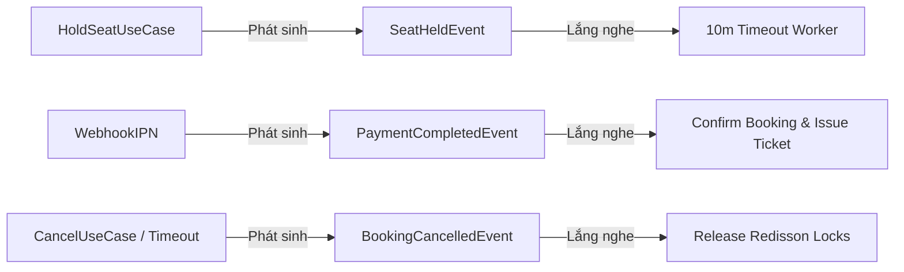

# 04.3. Hợp Đồng Thông Điệp Sự Kiện (Event Message Contracts)

Đặc tả cấu trúc dữ liệu Payload của các Domain Events nội bộ:



### 1. `SeatHeldEvent`
```json
{
  "eventType": "SEAT_HELD",
  "bookingReference": "550e8400-e29b-41d4-a716-446655440000",
  "tripId": 1,
  "seatNumbers": ["12A", "12B"],
  "expiresAt": "2026-11-20T08:10:00"
}
```

### 2. `PaymentCompletedEvent`
```json
{
  "eventType": "PAYMENT_COMPLETED",
  "paymentReference": "PAY_98F3A2B1C4D5E6F7",
  "bookingId": 105,
  "transactionId": "14567892",
  "amount": 2500000.00
}
```

### 3. `BookingCancelledEvent`
```json
{
  "eventType": "BOOKING_CANCELLED",
  "bookingReference": "550e8400-e29b-41d4-a716-446655440000",
  "tripId": 1,
  "seatNumbers": ["12A", "12B"]
}
```
