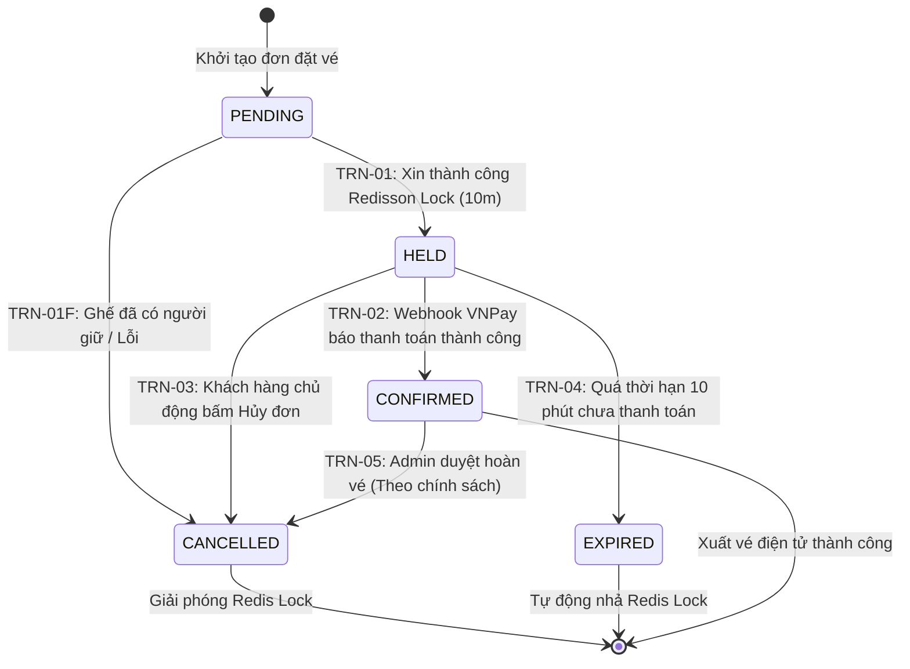

# 05.2. Máy Trạng Thái Đơn Vé (Booking State Machine - FSM)

## 1. Sơ Đồ Chuyển Đổi Trạng Thái (State Diagram)

---

## 2. Bảng Ma Trận Chuyển Đổi Hợp Lệ (State Transitions)

| Mã Bước Chuyển | Trạng Thái Ban Đầu | Trạng Thái Đích | Điều Kiện Kích Hoạt (Guard) | Tác Vụ Kèm Theo (Side Effects) |
| :--- | :--- | :--- | :--- | :--- |
| `TRN-01` | `PENDING` | `HELD` | Xin thành công khóa phân tán Redisson cho toàn bộ ghế yêu cầu | Đặt `expiresAt = now + 10m`, lưu đơn vé HELD, phát `EVT-SEAT-HELD` |
| `TRN-02` | `HELD` | `CONFIRMED` | Webhook VNPay báo `vnp_ResponseCode == "00"` và số tiền khớp | Đánh dấu thanh toán thành công, gửi vé điện tử cho khách |
| `TRN-03` | `HELD` | `CANCELLED` | Khách hàng chủ động gửi yêu cầu hủy đơn vé | Đổi trạng thái `CANCELLED`, giải phóng ngay các khóa Redis tương ứng |
| `TRN-04` | `HELD` | `EXPIRED` | Thời gian thực tế vượt quá `expiresAt` (10 phút) | Tự động nhả khóa Redis, ghế quay lại kho ghế trống |
| `TRN-05` | `CONFIRMED` | `CANCELLED` | Quản trị viên hủy vé theo chính sách hoàn trả | Kích hoạt quy trình hoàn tiền qua cổng thanh toán |
