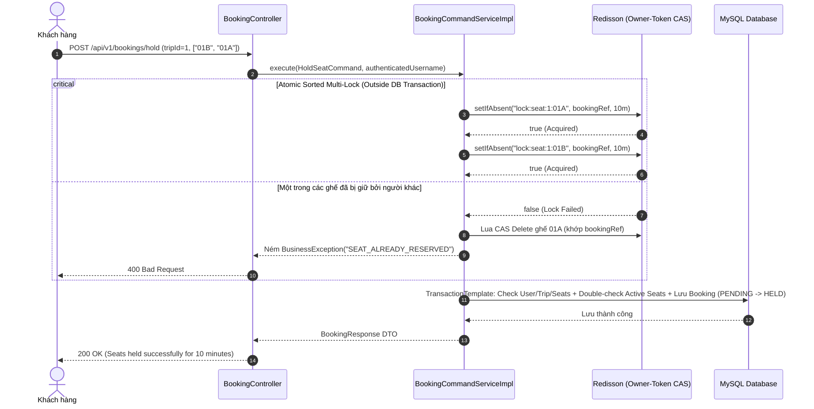
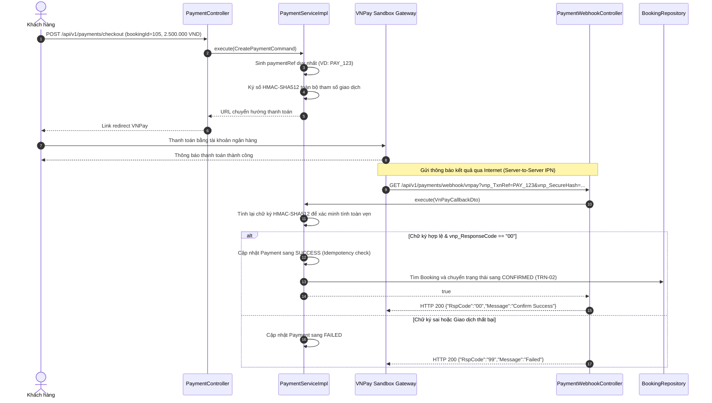

# 05.3. Sơ Đồ Tuần Tự Các Luồng Trọng Yếu (Concurrency Workflows)

## 1. Luồng Giữ Ghế Ngăn Chặn Race Condition (Redisson Distributed Lock)
- **Truy vết:** [`REQ-BKG-01`](../01-business-requirements/04.booking-and-concurrency.md#req-bkg-01), [`REQ-BKG-02`](../01-business-requirements/04.booking-and-concurrency.md#req-bkg-02) $\to$ [`API-BKG-01`](../04-api-and-events/02.endpoints-specification.md#api-bkg-01) $\to$ [`TRN-01`](02.booking-state-machine.md#trn-01).

---

## 2. Luồng Thanh Toán & Xử Lý Webhook IPN Idempotent
- **Truy vết:** [`REQ-PAY-01`](../01-business-requirements/05.payment-and-integration.md#req-pay-01), [`REQ-PAY-02`](../01-business-requirements/05.payment-and-integration.md#req-pay-02) $\to$ [`API-PAY-01`](../04-api-and-events/02.endpoints-specification.md#api-pay-01), [`API-PAY-02`](../04-api-and-events/02.endpoints-specification.md#api-pay-02) $\to$ [`TRN-02`](02.booking-state-machine.md#trn-02).

