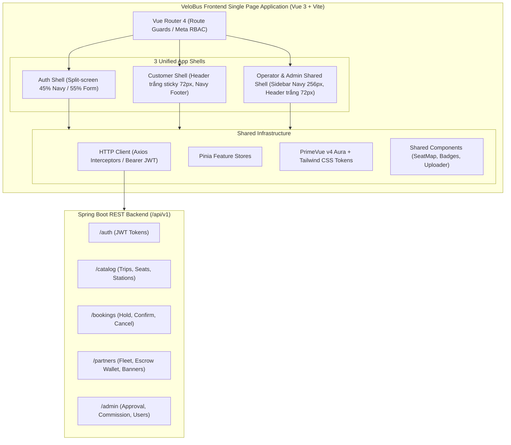

# 06.1. Kiến Trúc Tổng Thể & Quy Chuẩn Kỹ Thuật Frontend (`FE-ARCH`)

> **Định hướng thiết kế:** Direction A — Premium Mobility SaaS (Single Source of Truth: [FRONTEND_UI_UX_DESIGN_GUIDELINES.md](../../FRONTEND_UI_UX_DESIGN_GUIDELINES.md))  
> **Ngôn ngữ:** Tiếng Việt (Technical tokens bằng Tiếng Anh)  
> **Phạm vi:** Authentication · Customer Portal · Operator Portal · Platform Admin

---

## 1. Tổng Quan Kiến Trúc (Architecture Overview)

Dự án Frontend của hệ sinh thái **VeloBus** được tổ chức theo mô hình **Monorepo** (thư mục `frontend/`), kết nối với Backend Spring Boot qua RESTful APIs. Kiến trúc mã nguồn được quy hoạch theo mô hình **Feature-Sliced / Modular Architecture** với 3 App Shells chuyên biệt:



---

## 2. Công Nghệ & Thư Viện Cốt Lõi (Tech Stack)

| Thành Phần | Công Nghệ / Thư Viện | Phiên Bản | Mục Đích Sử Dụng |
| :--- | :--- | :---: | :--- |
| **Framework** | Vue.js | `^3.5.0` | Nền tảng SPA với Composition API và cú pháp `<script setup>`. |
| **Build Tool** | Vite | `^6.0.0` | Dev server HMR tức thì và Rollup bundler tối ưu hóa production. |
| **Component Library** | PrimeVue | `^4.0.0` | UI Components chuẩn doanh nghiệp (DataTable, Drawer, Dialog, Toast, Select, DatePicker). |
| **CSS & Design** | Tailwind CSS | `^3.4.0` | Utility-first CSS ánh xạ 1-1 với Design Tokens chuẩn (`--brand-navy`, `--primary-600`, `--canvas`). |
| **State Management** | Pinia | `^2.3.0` | Quản lý trạng thái tập trung chia theo Feature Stores (`auth`, `booking`, `partner`, `admin`). |
| **Routing** | Vue Router | `^4.5.0` | Định tuyến client-side với Navigation Guards kiểm soát quyền RBAC. |
| **HTTP Client** | Axios | `^1.7.0` | Gọi REST API, tự động bóc tách envelope `ApiResponse<T>` và đính kèm JWT Bearer. |
| **Icons** | Lucide Vue Next | Latest | Hệ thống icon tối giản, stroke 1.75–2, kích thước 16/18/20/24px đồng bộ. |

---

## 3. Cấu Trúc Thư Mục Feature-Sliced (Directory Structure)

Thư mục `frontend/src/` được quy hoạch theo 3 tầng rõ ràng:

```
frontend/src/
├── app/                              # Cấu hình cấp ứng dụng
│   ├── layouts/                      # 3 App Shells theo vai trò
│   │   ├── AuthLayout.vue            # Split-screen 45% Navy / 55% Form (max 420px)
│   │   ├── CustomerLayout.vue        # Header sticky 72px, max-width 1280px, Footer navy
│   │   ├── OperatorLayout.vue        # Sidebar navy 256px/76px, Header 72px (Dùng chung Dashboard Shell)
│   │   └── AdminLayout.vue           # CÙNG Dashboard Shell với Operator (khác menu & permissions)
│   └── router/
│       └── index.js                  # Định tuyến toàn app, metadata & RBAC Guards
├── assets/                           # CSS toàn cục, fonts, hình ảnh tĩnh
│   └── main.css                      # Định nghĩa CSS Design Tokens & Tailwind directives
├── shared/                           # Tầng dùng chung không phụ thuộc module
│   ├── api/                          # Axios instance, cấu hình interceptors
│   │   └── httpClient.js
│   ├── components/                   # Atomic components dùng chung
│   │   ├── StatusBadge.vue           # Badge màu trạng thái FSM (HOLDING, CONFIRMED, ...)
│   │   ├── CurrencyText.vue          # Hiển thị số tiền VND chuẩn font-variant-numeric: tabular-nums
│   │   ├── FirebaseUploader.vue      # Kéo thả ảnh upload thẳng lên /api/v1/public/upload
│   │   └── SeatMap2Deck.vue          # Sơ đồ chọn ghế xe 2 tầng tương tác
│   ├── composables/                  # Vue Composables logic tái sử dụng
│   │   └── useCountdown.js           # Đếm ngược 10 phút giữ chỗ dạng mm:ss tabular-nums
│   └── utils/                        # Hàm tiện ích (format date, format tiền)
│       └── formatters.js
├── modules/                          # Các tính năng nghiệp vụ độc lập (Feature Slices)
│   ├── auth/                         # Định danh & Phân quyền
│   │   ├── api.js                    # API login, register, get profile
│   │   ├── store.js                  # Pinia Auth Store (lưu user, role, token)
│   │   └── views/
│   │       └── LoginView.vue         # Form đăng nhập split-screen kèm seed tài khoản nhanh
│   ├── catalog-booking/              # Đặt vé & Tra cứu chuyến đi (Customer)
│   │   ├── api.js                    # API tìm chuyến, khóa ghế, hủy vé, thanh toán
│   │   ├── store.js                  # Booking state, thông tin chuyến đang chọn
│   │   ├── components/
│   │   │   ├── TripSearchBar.vue     # Thanh tìm điểm đi, điểm đến, ngày khởi hành
│   │   │   └── TripCard.vue          # Thẻ thông tin chuyến đi & giá vé
│   │   └── views/
│   │       ├── HomeView.vue          # Trang chủ tra cứu vé + Banner nổi bật
│   │       └── MyBookingsView.vue    # Lịch sử đặt vé & QR code vé điện tử HMAC
│   ├── partner/                      # Phân hệ đối tác nhà xe (Operator)
│   │   ├── api.js                    # API đội xe, chuyến xe, ví ký quỹ, banner
│   │   └── views/
│   │       ├── OperatorDashboardView.vue  # Dashboard ví ký quỹ 4 số dư & KPI
│   │       ├── FleetAndDriversView.vue    # Quản lý phương tiện & tài xế (Right Drawer Form)
│   │       ├── OperatorTripsView.vue      # Lập lịch chuyến đi (Buffer 30 phút)
│   │       └── OperatorBannersView.vue    # Đăng ký banner quảng cáo
│   └── admin/                        # Phân hệ ban quản trị (Admin Backoffice)
│       ├── api.js                    # API duyệt nhà xe, hoa hồng 2 cấp, duyệt banner
│       └── views/
│           ├── AdminDashboardView.vue     # Tổng quan doanh thu & hoa hồng toàn sàn
│           ├── AdminOperatorsView.vue     # Danh sách & xét duyệt nhà xe
│           ├── AdminWithdrawalsView.vue   # Duyệt yêu cầu rút tiền ví ký quỹ
│           └── AdminBannersView.vue       # Kiểm duyệt banner quảng cáo
├── App.vue                           # Root component chứa RouterView & Toast/ConfirmDialog
└── main.js                           # Khởi tạo App, PrimeVue, Pinia, Router
```

---

## 4. Quy Chuẩn Đặt Mã Tọa Độ Định Danh (`FE-ARCH-*`)

| Mã Định Danh | Quy Chuẩn Kiến Trúc | Mô Tả & Ràng Buộc Kỹ Thuật |
| :--- | :--- | :--- |
| `FE-ARCH-01` | **Feature-Sliced Modularity** | Phân rã theo Feature Slices (`auth`, `catalog-booking`, `partner`, `admin`). Không đặt logic nghiệp vụ trong `shared/`. |
| `FE-ARCH-02` | **Strict API Envelope Binding** | Mọi API response nhận gói `ApiResponse<T>` `{ success, code, message, data }`. Tự động ném lỗi nếu `success === false`. |
| `FE-ARCH-03` | **JWT Token Storage & Rotation** | Access Token lưu tại `localStorage` với key `velobus_access_token`. Khi nhận HTTP 401 tự động xóa token và chuyển hướng về `/login`. |
| `FE-ARCH-04` | **Route-Level RBAC Enforcement** | Vue Router kiểm tra `meta.requiresAuth` và `meta.role` trước khi navigation. Từ chối và chuyển hướng nếu không đúng vai trò. |
| `FE-ARCH-05` | **Component File Limit (Max 400)** | Tuyệt đối cấm component vượt quá 400 dòng code. Khi quá 400 dòng, bắt buộc tách thành các Sub-component trong thư mục `components/` của module. |
| `FE-ARCH-06` | **Direct Cloud Upload Binding** | Toàn bộ upload ảnh/file gọi endpoint backend `/api/v1/public/upload` nhận URL Firebase Storage, không lưu base64 trong cơ sở dữ liệu. |
| `FE-ARCH-07` | **Single Shell for Dashboard** | Phân hệ Operator và Admin **bắt buộc dùng chung một Shell Dashboard** (Sidebar navy 256px + Header trắng 72px), không viết 2 shell riêng biệt. |
| `FE-ARCH-08` | **Accessible Forms & Drawers** | Mọi form tạo/sửa dài dùng Right-Side Drawer (520px/680px), Header và Footer cố định, phím Escape đóng được và trap focus chuẩn. |
