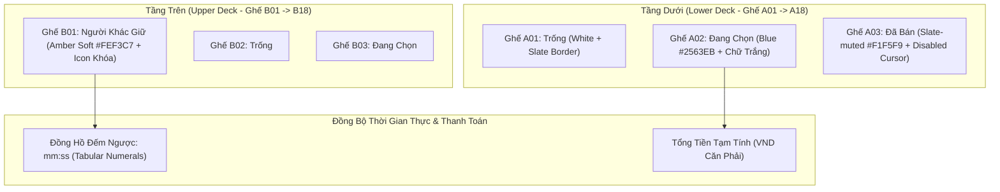

# 06.2. Hệ Thống Thiết Kế UI/UX & Tích Hợp Stitch (`FE-DS`)

> **Single Source of Truth:** [FRONTEND_UI_UX_DESIGN_GUIDELINES.md](../../FRONTEND_UI_UX_DESIGN_GUIDELINES.md)  
> **Định hướng hình ảnh:** Direction A — Premium Mobility SaaS  
> **Mặc định:** Light Theme  
> **Font:** `Inter`, fallback `Be Vietnam Pro`, `system-ui`, `sans-serif`

---

## 1. Triết Lý Thiết Kế VeloBus

Hệ thống thiết kế của **VeloBus** phản ánh bản sắc **Premium Mobility SaaS**:
* **Premium:** Ưu tiên khoảng trắng, tỷ lệ vàng, đường viền thanh mảnh và sự tinh tế trong tương tác.
* **Mobility:** Cảm giác di chuyển nhanh, thông tin lịch trình và giờ xe khởi hành rõ ràng, đáng tin cậy.
* **SaaS:** Bố cục dạng dữ liệu chuyên nghiệp (Data-dense), bảng biểu mạnh mẽ, tối ưu hóa thao tác vận hành trên tập dữ liệu lớn của nhà xe và quản trị viên.

---

## 2. Bảng Mã Design Tokens Chính Thức (`FE-DS-*`)

Toàn bộ giao diện bắt buộc sử dụng hệ thống tokens thống nhất dưới đây; **tuyệt đối không hardcode mã màu hoặc khoảng cách tùy tiện**:

### 2.1. Brand & Neutral Tokens

| Mã Token | Tên Biến CSS | Giá Trị HEX | Mục Đích Sử Dụng |
| :--- | :--- | :---: | :--- |
| `FE-DS-BRAND-01` | `--brand-navy` | `#142B4A` | Logo, Sidebar Admin/Operator, Footer Customer, Hero tối. |
| `FE-DS-BRAND-02` | `--brand-navy-hover`| `#1E3A5F` | Trạng thái hover menu trên nền Navy. |
| `FE-DS-PRI-01` | `--primary-600` | `#2563EB` | Nút bấm chính (Primary CTA), Active Tab/Menu, Link điều hướng, Ghế đang chọn. |
| `FE-DS-PRI-02` | `--primary-700` | `#1D4ED8` | Trạng thái hover của nút Primary. |
| `FE-DS-PRI-03` | `--primary-100` | `#DBEAFE` | Nền highlight mềm, badge info. |
| `FE-DS-ACC-01` | `--accent-500` | `#F59E0B` | Điểm nhấn thương mại, banner ưu đãi, thông tin cần chú ý. |
| `FE-DS-SURF-01` | `--canvas` | `#F8FAFC` | Nền tổng thể ứng dụng (App canvas background). |
| `FE-DS-SURF-02` | `--surface` | `#FFFFFF` | Nền Card, Form, Table, Modal, Drawer. |
| `FE-DS-SURF-03` | `--surface-muted` | `#F1F5F9` | Nền Header bảng dữ liệu, nền thẻ phụ, ghế đã bán/không khả dụng. |
| `FE-DS-BORD-01` | `--border-default` | `#E2E8F0` | Đường viền mặc định của Card, Table border, Divider. |
| `FE-DS-BORD-02` | `--border-strong` | `#CBD5E1` | Đường viền Form Input, Select, DatePicker. |
| `FE-DS-TXT-01` | `--text-primary` | `#0F172A` | Màu chữ nội dung chính, tiêu đề, số liệu KPI. |
| `FE-DS-TXT-02` | `--text-secondary` | `#475569` | Màu chữ phụ, mô tả ngắn, nhãn trường nhập liệu. |
| `FE-DS-TXT-03` | `--text-muted` | `#64748B` | Placeholder, metadata, nhãn phụ (đảm bảo độ tương phản WCAG AA). |
| `FE-DS-TXT-04` | `--text-inverse` | `#FFFFFF` | Màu chữ trên nền tối (Sidebar, Footer, Primary Button). |

### 2.2. Semantic Colors (Trạng Thái Nghiệp Vụ)

| Trạng thái | Mã Token | Chữ (Foreground) | Nền (Background) | Mục Đích Sử Dụng |
| :--- | :--- | :---: | :---: | :--- |
| **Success** | `FE-DS-SEM-SUC` | `#166534` | `#DCFCE7` | Đặt vé thành công, Lệnh rút tiền đã duyệt (`COMPLETED`), Số dư khả dụng (`AVAILABLE`). |
| **Warning** | `FE-DS-SEM-WAR` | `#92400E` | `#FEF3C7` | Ghế đang được người khác giữ, Chờ duyệt (`PENDING_APPROVAL`), Sắp hết hạn giữ chỗ. |
| **Danger** | `FE-DS-SEM-DAN` | `#991B1B` | `#FEE2E2` | Lệnh rút tiền bị từ chối (`REJECTED`), Vé đã hủy (`CANCELLED`), Hết hạn giữ chỗ (`EXPIRED`). |
| **Info** | `FE-DS-SEM-INF` | `#1D4ED8` | `#DBEAFE` | Thông tin hành trình, nhắc nhở trước giờ xuất bến, phiên bản hệ thống. |
| **Neutral** | `FE-DS-SEM-NEU` | `#475569` | `#F1F5F9` | Nhãn trạng thái phương tiện ngừng hoạt động, ghế đã bán. |

### 2.3. Quy Chuẩn Bo Góc (Radius) & Đổ Bóng (Elevation)

* `--radius-sm` (6px): Badges, Tags.
* `--radius-md` (8px): Inputs, Buttons, Dropdown items.
* `--radius-lg` (12px): Cards, KPI blocks.
* `--radius-xl` (16px): Drawers, Dialogs, Modals.
* `--radius-hero` (20px): Hero panel, Promotional banners.
* `--radius-full` (50%): Avatars.
* **Shadow Card:** `0 2px 8px rgba(15, 23, 42, .04)` (ưu tiên viền border hơn shadow đậm).
* **Shadow Dialog:** `0 20px 60px rgba(15, 23, 42, .18)`.

---

## 3. Tích Hợp Stitch UI Generator (`stitch-mcp`)

Để đảm bảo các bản thiết kế sinh ra từ **Stitch** luôn bám sát chuẩn nhận diện thương hiệu của VeloBus, kỹ sư và AI bắt buộc áp dụng cấu hình và prompt chuẩn sau:

### 3.1. Cấu Hình Theme Stitch Cho Dự Án VeloBus
```json
{
  "projectType": "TEXT_TO_UI_PRO",
  "deviceType": "DESKTOP",
  "designTheme": {
    "colorMode": "LIGHT",
    "font": "INTER",
    "roundness": "ROUND_EIGHT",
    "customColor": "#2563EB",
    "overridePrimaryColor": "#2563EB",
    "overrideSecondaryColor": "#142B4A",
    "overrideTertiaryColor": "#F59E0B",
    "overrideNeutralColor": "#0F172A"
  }
}
```

### 3.2. Mẫu Prompt Chuẩn Khi Dùng `stitch-mcp:generate_screen_from_text`
```
Design a modern, clean, light-mode screen for "VeloBus - Premium Mobility SaaS".
Visual Direction:
- Theme: Direction A (Premium Mobility SaaS), strictly light mode, canvas #F8FAFC, surface #FFFFFF.
- Brand colors: Primary Blue #2563EB, Sidebar/Brand Navy #142B4A, Accent Amber #F59E0B.
- Typography: Inter, clear hierarchy, tabular numbers for monetary/time values.
- Controls: PrimeVue and Tailwind compatible components, inputs 44px, radius 8px for buttons/inputs, 12px for cards.
- Layout: [Mô tả chi tiết layout: Customer Shell / Operator Drawer / Seat Map 2-deck]
```

### 3.3. Quy Trình Chuyển Hóa Từ Stitch Mockup Sang Mã Nguồn Vue 3
1. **Trích xuất Layout:** Tái sử dụng grid Tailwind (`grid-cols-12`, `gap-6`, `flex`, `items-center`).
2. **Gắn PrimeVue Components:** Thay các form control tĩnh bằng component PrimeVue chính thức (`<InputText>`, `<DataTable>`, `<Drawer>`, `<Dialog>`).
3. **Áp Dụng Token Classes:** Dùng class Tailwind token (`bg-brand-navy`, `bg-primary-600`, `text-primary`, `border-border-default`).

---

## 4. Đặc Tả Ngôn Ngữ Hiển Thị Sơ Đồ Chọn Ghế 2 Tầng (`FE-DS-SEATMAP`)

Sơ đồ ghế xe khách 2 tầng (Limousine / Giường nằm) tuân thủ nghiêm ngặt bảng trạng thái hiển thị tại Mục 17 của file guideline:



### Bảng Trạng Thái Ghế & Tương Tác:

| Trạng Thái Hiển Thị | Visual Styling (Tailwind / CSS) | Khả Năng Click | Ý Nghĩa Nghiệp Vụ |
| :--- | :--- | :---: | :--- |
| **Available** (Còn trống) | `bg-white border-slate-300 hover:border-blue-500 cursor-pointer text-slate-800` | Có | Ghế chưa có ai đặt, sẵn sàng để chọn. |
| **Selected** (Khách đang chọn) | `bg-blue-600 text-white font-bold ring-2 ring-blue-300 cursor-pointer` | Có (bỏ chọn) | Khách đang chọn cục bộ trên máy khách, chưa gửi lệnh giữ chỗ. |
| **Unavailable / Sold** (Đã bán) | `bg-slate-100 text-slate-400 border-slate-200 cursor-not-allowed` | Không | Ghế đã thanh toán xong hoặc vé đã xuất. Cấm click. |
| **Held by other user** (Người khác giữ) | `bg-amber-100 text-amber-800 border-amber-300 cursor-not-allowed flex items-center justify-center` | Không | Ghế đang trong phiên giữ chỗ 10 phút của người khác. Có biểu tượng ổ khóa nhỏ. |
| **Confirmed own hold** (Phiên giữ của mình) | `border-2 border-blue-600 bg-blue-50 text-blue-800 font-bold` | Không | Ghế đã gọi API giữ chỗ thành công cho chính khách này, gắn với đồng hồ đếm ngược. |
| **Focused** | `ring-2 ring-blue-500 ring-offset-2 outline-none` | Có | Hỗ trợ điều hướng bằng bàn phím (Keyboard Accessible). |

* **Đồng hồ đếm ngược (Hold Timer):** Hiển thị dạng `mm:ss` với `font-variant-numeric: tabular-nums`, cảnh báo vàng khi còn dưới 2 phút, không nhấp nháy gây khó chịu cho người dùng.
* **Bảng chú giải (Legend):** Đặt ngay bên cạnh hoặc phía trên sơ đồ ghế; luôn có cả màu sắc + text nhãn rõ ràng (không chỉ dùng màu).


---

## 4. Dự Án Stitch MCP Chính Thức Của Dự Án (`STITCH-PROJ`)

Dự án thiết kế giao diện AI Stitch đã được khởi tạo và cấu hình đầy đủ Design System trên Google Stitch:

| Thuộc Tính | Giá Trị Cấu Hình Trên Stitch MCP |
| :--- | :--- |
| **Project ID** | `projects/7031998889146609699` |
| **Project Title** | `VeloBus - Premium Mobility SaaS` |
| **Web Console Link** | [https://stitch.withgoogle.com](https://stitch.withgoogle.com) |
| **Theme & Color Mode** | `LIGHT`, Roundness `ROUND_EIGHT`, Spacing Scale `2` |
| **Brand Colors** | Primary: `#2563EB` • Secondary: `#142B4A` • Tertiary: `#F59E0B` • Neutral: `#64748B` |
| **Typography** | Font Family: `Inter`, Heading: `Inter`, Body: `Inter`, Code: `tabular-nums` |

### Danh Sách Screens Đã Tạo & Đồng Bộ Trên Stitch:
1. **Screen `d5b0031050ff4ae4a8382fbfca348063`:**
   - **Tiêu đề:** `VeloBus - Chọn chỗ & Đặt vé` (`FE-SCR-CUST-03`)
   - **Độ phân giải:** `2560 x 3302` (Desktop High-Res)
   - **Assets:** Screenshot PNG & HTML Code bundle đồng bộ trực tiếp từ Stitch MCP.
2. **Screen `74bd918ef9e741dd9624de8f1b7165e8`:**
   - **Tiêu đề:** `Fintech Escrow Dashboard & Payout Management` (`FE-SCR-OPER-01`)
   - **Độ phân giải:** `2560 x 3156` (Desktop High-Res)
   - **Mô tả:** Dashboard ví 4 số dư ký quỹ (`AVAILABLE`, `HOLDING_ESCROW`, `SETTLING`, `WITHDRAWN`), banner ngân hàng thụ hưởng xác minh KYC và bảng sao kê lịch sử giao dịch.
3. **Screen `4e909110885f4aa4b302b413417bcfa7`:**
   - **Tiêu đề:** `VeloBus Platform Governance & VNPay Reconciliation Dashboard` (`FE-SCR-ADM-01`)
   - **Độ phân giải:** `2560 x 4564` (Desktop High-Res)
   - **Mô tả:** Trung tâm điều hành Super Admin, khối cảnh báo lệch đối soát IPN VNPay thời gian thực, bảng hiệu suất nhà xe theo mô hình hoa hồng 2 cấp (Two-Tier Commission) và khung xử lý sự cố khẩn cấp.
4. **Screen `a1c763d98f854dc4a5859dbcac5698b1`:**
   - **Tiêu đề:** `VeloBus Partner Workspace - Fleet & Trip Schedule Management` (`FE-SCR-OPER-02`, `FE-SCR-OPER-03`)
   - **Độ phân giải:** `2560 x 2568` (Desktop High-Res)
   - **Mô tả:** Quản lý đội xe, tài xế và lịch trình chạy xe tích hợp quy chuẩn Turnaround Buffer 30 phút chống trùng lịch xe và tài xế, drawer lập chuyến mới.
5. **Screen `0c0c51cfabda47c08fb8b230245acd33`:**
   - **Tiêu đề:** `VeloBus - Đơn Vé Của Tôi & Vé Điện Tử` (`FE-SCR-CUST-05`)
   - **Độ phân giải:** `2560 x 2918` (Desktop High-Res)
   - **Mô tả:** Thẻ lên xe điện tử chuẩn hàng không (E-Boarding Pass), mã QR bảo mật mã hóa HMAC-SHA256 chống làm giả vé, chính sách hủy vé hoàn tiền 3 nấc.
