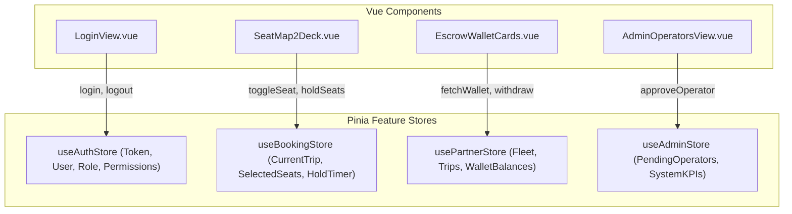
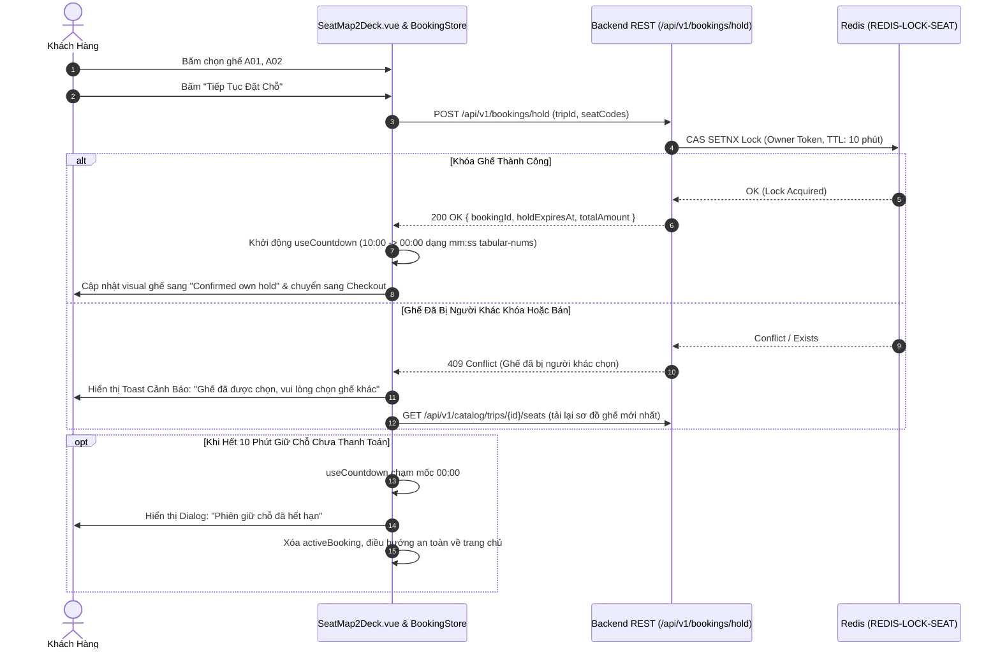

# 06.4. Quản Lý Trạng Thái Pinia & Luồng Dữ Liệu (`FE-STATE`)

> **Quy tắc thiết kế:** Tuân thủ 100% [FRONTEND_UI_UX_DESIGN_GUIDELINES.md](../../FRONTEND_UI_UX_DESIGN_GUIDELINES.md)  
> **Nguyên tắc quản lý trạng thái:** Tách bạch Visual State (client-side) và Business State (authoritative server-side).

---

## 1. Kiến Trúc Quản Lý Trạng Thái Pinia (State Management Architecture)

Hệ thống sử dụng **Pinia** làm bộ nhớ trạng thái trung tâm, được chia thành các Feature Stores độc lập tương ứng với các phân hệ nghiệp vụ:

---

## 2. Danh Mục Các Store Cốt Lõi (`FE-STATE-*`)

| Mã Store | Tên Store & File | State & Getters Chính | Actions / API Calls |
| :--- | :--- | :--- | :--- |
| `FE-STATE-01` | **Auth Store** `modules/auth/store.js` | • `token`: Chuỗi JWT Bearer. • `user`: Thông tin người dùng (`id`, `fullName`, `email`, `role`). • `role`: Vai trò (`CUSTOMER`, `OPERATOR`, `ADMIN`). • `isAuthenticated`: Boolean kiểm tra token hợp lệ. | • `login(credentials)`: Gọi API, lưu token `localStorage`. • `logout()`: Xóa token, reset toàn bộ state, chuyển hướng về `/login`. • `fetchProfile()`: Nạp lại thông tin người dùng từ Backend. |
| `FE-STATE-02` | **Booking Store** `modules/catalog-booking/store.js` | • `currentTrip`: Chi tiết chuyến đi đang xem. • `selectedSeats`: Mảng mã ghế đang chọn `['A01', 'A02']`. • `activeBooking`: Đơn đặt vé hiện hành sau khi giữ chỗ. • `holdExpiresAt`: Thời điểm hết hạn phiên giữ chỗ. • `totalAmount`: Tổng tiền tạm tính căn phải. | • `selectTrip(tripId)`: Nạp thông tin chuyến và sơ đồ ghế từ `API-CAT-02`. • `toggleSeat(seatCode)`: Chọn / bỏ chọn ghế cục bộ. • `holdSelectedSeats()`: Gọi `API-BKG-01` khóa ghế trên Redis. • `releaseHeldSeats()`: Hủy phiên giữ chỗ hoặc reset khi hết giờ. |
| `FE-STATE-03` | **Partner Store** `modules/partner/store.js` | • `wallet`: 4 số dư ví ký quỹ (`available`, `holding`, `settling`, `withdrawn`). • `vehicles`: Danh sách phương tiện của nhà xe. • `drivers`: Danh sách tài xế. • `trips`: Lịch trình các chuyến xe do nhà xe vận hành. | • `fetchWalletSummary()`: Gọi `API-PARTNER-05`. • `requestWithdrawal(amount, bankInfo)`: Gọi `API-PARTNER-06`. • `createTrip(payload)`: Tạo chuyến mới (kiểm tra buffer 30p). |
| `FE-STATE-04` | **Admin Store** `modules/admin/store.js` | • `pendingOperators`: Hồ sơ nhà xe chờ xét duyệt. • `withdrawalsQueue`: Danh sách lệnh rút tiền cần duyệt. • `systemKpi`: Doanh thu toàn sàn, hoa hồng, đơn vé. | • `approveOperator(id)` / `rejectOperator(id)`: Gọi `API-ADM-PARTNER-01`. • `approveWithdrawal(id)`: Gọi `API-ADM-PARTNER-03`. • `saveCommissionRate(rate)`: Gọi `API-ADM-PARTNER-02`. |

---

## 3. Luồng Giữ Chỗ Đồng Thời & Đồng Hồ Đếm Ngược (Concurrency Data Flow)

Cơ chế giữ chỗ 10 phút là luồng dữ liệu thời gian thực quan trọng nhất của sàn thương mại vé:

---

## 4. Xử Lý Lỗi Tập Trung & Axios Interceptors (`FE-STATE-ERR`)

Toàn bộ request và response của Axios Client được bọc gói an toàn tại `src/shared/api/httpClient.js`:

1. **Request Interceptor:**
   * Tự động lấy token từ `localStorage.getItem('velobus_access_token')`.
   * Gắn header: `Authorization: Bearer <token>`.
2. **Response Interceptor:**
   * Bóc tách bọc gói `ApiResponse<T>`: Nếu `response.data.success === true`, trả về trực tiếp `response.data.data`.
   * Nếu `response.data.success === false`, chủ động ném `new Error(response.data.message)`.
3. **Error Interceptor Phân Cấp:**
   * **Mã HTTP 401 (Unauthorized):** Token hết hạn hoặc không hợp lệ. Tự động xóa token khỏi `localStorage` và chuyển hướng về `/login` kèm Toast: *"Phiên làm việc đã hết hạn. Vui lòng đăng nhập lại."*
   * **Mã HTTP 403 (Forbidden):** Người dùng không có quyền truy cập endpoint này. Hiển thị Toast Warning: *"Bạn không có quyền thực hiện hành động này."*
   * **Mã HTTP 400 / 409 (Business Exception):** Bóc tách chính xác thông điệp từ Backend (ví dụ: *"Ghế đã bị khóa bởi người khác"*, *"Thời gian nghỉ giữa 2 chuyến phải tối thiểu 30 phút"*) và hiển thị Toast Warning thân thiện bằng Tiếng Việt.
   * **Mã HTTP 500 / Network Error:** Hiển thị Toast Error: *"Không thể kết nối đến máy chủ. Vui lòng thử lại sau ít phút."* Tuyệt đối không để lộ raw stack trace ra giao diện người dùng.
