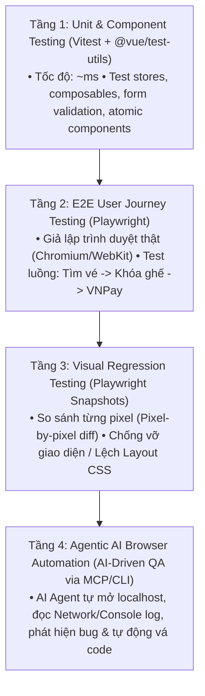

# 06.5. Tiêu Chuẩn Kiểm Định Chất Lượng & QA Frontend (`FE-QA`)

> **Single Source of Truth:** [FRONTEND_UI_UX_DESIGN_GUIDELINES.md](../../FRONTEND_UI_UX_DESIGN_GUIDELINES.md) (Mục 25: Checklist review giao diện)  
> **Nguyên tắc nghiệm thu:** Zero tolerance đối với lỗi rò rỉ mã màu tùy tiện, lệch App Shell, hoặc mất khả năng tiếp cận bàn phím (Keyboard Accessibility).

---

## 1. Mục Đích & Phạm Vi Áp Dụng

Tài liệu này là quy chuẩn bắt buộc để các kỹ sư Frontend và Subagents kiểm định độc lập (`implementation-reviewer`, `feature-qa`, `quality-gate`) đối chiếu, đánh giá và cấp phán quyết trước khi đóng bất kỳ Phase hoặc Feature nào của Frontend VeloBus.

---

## 2. Bảng Danh Mục Kiểm Định Toàn Diện (`FE-QA-*`)

### 2.1. Kiểm Định Visual & Design Tokens (`FE-QA-VIS`)

| Mã Kiểm Định | Tiêu Chí Kiểm Tra | Kết Quả Đạt Chuẩn (PASS) | Lỗi Không Đạt (FAIL) |
| :--- | :--- | :--- | :--- |
| `FE-QA-VIS-01` | **Tuân thủ Design Tokens** | Toàn bộ màu lấy từ bảng tokens CSS (`--brand-navy`, `--primary-600`, `--accent-500`, `--canvas`, `--surface`). | Tự tiện thêm mã HEX lạ (như `#333`, `#f00`, tím `#4F46E5` cũ) trong component. |
| `FE-QA-VIS-02` | **Phân cấp Typography** | Đúng thang kích thước font từ H1 (30px/700) đến Body (14-15px/400). | Dùng font dưới 12px cho dữ liệu quan trọng, chữ hoa toàn bộ đoạn văn. |
| `FE-QA-VIS-03` | **Tabular Numerals** | Mọi giá trị tiền tệ, số lượng, giờ xuất bến và đồng hồ đếm ngược đều sử dụng `font-variant-numeric: tabular-nums`. | Số tiền hoặc đồng hồ giật layout khi nhảy số. |
| `FE-QA-VIS-04` | **Spacing & Border Radius** | Khoảng cách tuân thủ hệ 4px (8, 12, 16, 20, 24, 32px). Radius: Badge 6px, Input/Button 8px, Card 12px, Drawer 16px. | Dùng khoảng cách tùy tiện như 17px, 29px không có lý do. |
| `FE-QA-VIS-05` | **Đồng bộ Icon System** | 100% icon sử dụng thư viện **Lucide Icons** với kích thước chuẩn 16/18/20/24px. | Trộn icon từ nhiều thư viện khác nhau hoặc dùng emoji làm icon nghiệp vụ chính. |

---

### 2.2. Kiểm Định Bố Cục & App Shells (`FE-QA-LAY`)

| Mã Kiểm Định | Tiêu Chí Kiểm Tra | Kết Quả Đạt Chuẩn (PASS) | Lỗi Không Đạt (FAIL) |
| :--- | :--- | :--- | :--- |
| `FE-QA-LAY-01` | **App Shell Theo Vai Trò** | • Auth: Split-screen 45% Navy / 55% Form (max 420px). • Customer: Header trắng sticky 72px, max 1280px, Footer navy. • Operator & Admin: Dùng CHUNG Dashboard Shell (Sidebar navy 256px/76px, Header 72px). | Tạo 2 shell dashboard khác nhau cho Operator và Admin; header customer tràn màn hình. |
| `FE-QA-LAY-02` | **Responsive & Không Tràn Viewport** | Thao tác mượt mà trên Mobile (< 640px), Tablet (640-1023px), Laptop/Desktop (> 1024px). | Xuất hiện thanh cuộn ngang toàn trang (Horizontal Page Overflow) ngoài bảng dữ liệu. |
| `FE-QA-LAY-03` | **Right-Side Drawer Chuẩn** | Mọi form tạo/sửa dài dùng Drawer mở từ bên phải (520px hoặc 680px), Header và Footer cố định, Body cuộn riêng. | Nhồi nhét form nhập liệu nhiều trường vào Modal popup nhỏ khiến nội dung bị bóp méo. |
| `FE-QA-LAY-04` | **Touch Target Mobile** | Vùng bấm (Touch Target) của các nút và trường chọn trên mobile tối thiểu **44×44px**. | Các nút bấm quá nhỏ sát nhau khiến người dùng chạm nhầm trên điện thoại. |

---

### 2.3. Kiểm Định Tương Tác, Validation & Khả Năng Tiếp Cận (`FE-QA-INT`)

| Mã Kiểm Định | Tiêu Chí Kiểm Tra | Kết Quả Đạt Chuẩn (PASS) | Lỗi Không Đạt (FAIL) |
| :--- | :--- | :--- | :--- |
| `FE-QA-INT-01` | **Đầy Đủ 8 Trạng Thái Tương Tác** | Các phần tử tương tác hỗ trợ đủ: default / hover / focus / active / disabled / loading / error / success. | Nút submit đang gọi API mà không có spinner loading, cho phép bấm double click liên tục. |
| `FE-QA-INT-02` | **Keyboard & A11y (WCAG AA)** | Phím Tab duyệt tuần tự, phím Enter/Space kích hoạt nút, phím Escape đóng được Drawer/Dialog; Focus ring rõ ràng. | Bỏ outline/focus ring; mở Drawer mà không bẫy tiêu điểm (Trap Focus). |
| `FE-QA-INT-03` | **Form Validation & Giữ Dữ Liệu** | Báo lỗi inline dưới từng trường; khi submit thất bại từ API thì **không được xóa sạch dữ liệu người dùng đã gõ**. | Reset form trắng tinh khi server trả về lỗi nghiệp vụ. |
| `FE-QA-INT-04` | **Hành Động Phá Hủy Có Xác Nhận** | Các thao tác nguy hiểm (Hủy vé, Xóa xe, Từ chối nhà xe) bắt buộc có ConfirmDialog giải thích rõ ràng hậu quả. | Bấm một click xóa ngay dữ liệu mà không có bước xác nhận. |

---

### 2.4. Kiểm Định Tính Nhất Quán & Nghiệp Vụ VeloBus (`FE-QA-BIZ`)

| Mã Kiểm Định | Tiêu Chí Kiểm Tra | Kết Quả Đạt Chuẩn (PASS) | Lỗi Không Đạt (FAIL) |
| :--- | :--- | :--- | :--- |
| `FE-QA-BIZ-01` | **Sơ Đồ Ghế 2 Tầng Đúng 5 Trạng Thái** | Sơ đồ ghế hiển thị đúng: Trắng (Available), Blue (Selected), Amber mềm + Khóa (Held by other), Xám nhạt (Sold), Viền xanh đậm (Confirmed own hold). | Ghế đã bán tô màu đỏ chói; không có bảng chú giải (Legend) cạnh sơ đồ ghế. |
| `FE-QA-BIZ-02` | **Đếm Ngược Giữ Chỗ Thời Gian Thực** | Đồng hồ đếm ngược dạng `mm:ss tabular-nums`, khi chạm 00:00 khóa tương tác và hiện thông báo phiên hết hạn. | Đếm ngược chỉ chạy giả lập hoặc lệch thời gian thực với Redis Backend. |
| `FE-QA-BIZ-03` | **Bảo Mật & Xử Lý Lỗi** | Khi 401 tự động xóa token và chuyển hướng về `/login`. Toast thông báo Tiếng Việt thân thiện. | Để lộ stack trace Java, token JWT, password hoặc secret trong Toast/Log console. |
| `FE-QA-BIZ-04` | **Không Hiển Thị Dữ Liệu Giả Làm Dữ Liệu Thật** | Mọi số liệu KPI, biểu đồ, chuyến xe đều được nạp từ API thực tế hoặc Mock Service có kiểm soát. | Dùng đồ thị hoặc biểu đồ cứng vẽ sẵn để lấp chỗ trống. |

---

## 3. Kiến Trúc Kiểm Thử Tự Động 4 Tầng Cho Frontend (4-Tier Automated Testing Architecture)

Để đồng bộ với quy trình kiểm thử khắt khe của Backend (`mvn test` + `Postman/Newman`), Frontend áp dụng ma trận 4 tầng kiểm thử tự động toàn diện:

| Tầng Kiểm Thử | Công Cụ & Thư Viện | Đối Tượng Kiểm Thử Cụ Thể | Lệnh Chạy / Cách Thức Vận Hành |
| :--- | :--- | :--- | :--- |
| **1. Unit & Component** | `Vitest` `@vue/test-utils` `happy-dom` | • Logic đếm ngược 10 phút `useCountdown.js`. • Chuyển đổi bố cục `useLayoutWidth.js`. • Pinia Auth & Booking Stores. • Component đơn lẻ: `SeatMap2Deck.vue`, `StatusBadge.vue`, `AppButton.vue`. | `npm run test:unit` *(Chạy trong RAM, tốc độ mili-giây)* |
| **2. E2E User Journey** | `Playwright` (Headless / Headed) | • **Customer:** Đặt vé $\to$ Chọn ghế 2 tầng $\to$ Giữ chỗ 10p $\to$ Điền form $\to$ VNPay. • **Operator:** Đăng nhập $\to$ Mở Drawer thêm xe $\to$ Kiểm tra ví 4 số dư. • **Admin:** Duyệt nhà xe $\to$ Cập nhật bảng dữ liệu. | `npx playwright test` *(Tự động chụp ảnh, quay video và ghi lại network trace khi fail)* |
| **3. Visual Regression** | `Playwright Screenshots` (Golden Snapshots) | • Bắt lỗi vỡ bố cục khi sửa CSS/Tailwind. • So sánh ảnh chụp Sơ đồ ghế 2 tầng `seat-map-2deck.png`. • So sánh Split-Screen Auth & Dashboard Drawer. | `npx playwright test --update-snapshots` *(Báo lỗi nếu lệch quá ngưỡng `maxDiffPixelRatio: 0.01`)* |
| **4. Agentic AI Testing** | `Playwright MCP` hoặc `AI Agent CLI` | • AI trực tiếp điều khiển trình duyệt truy cập `http://localhost:5173`. • Bắt lỗi Console Logs, Network 4xx/5xx. • Tự động kích hoạt `root-cause-debugger` để vá code khi kịch bản thất bại. | AI tự động chạy kiểm thử trong quy trình `feature-qa` của từng Phase. |

---

## 4. Quy Trình Nghiệm Thu & Phán Quyết Chất Lượng (Quality Gate Protocol)

Mỗi khi hoàn thành một màn hình hoặc một Feature Slice:
1. **Lớp 1 (Unit/Component):** Chạy `npm run test:unit` (100% test pass).
2. **Lớp 2 (Visual & Build):** Chạy `npm run build` (Exit code = 0) và đối chiếu Checklist Mục 2.
3. **Lớp 3 (E2E Integration):** Chạy `npx playwright test` để xác minh tương tác người dùng thật.
4. **Lớp 4 (Security):** Chạy `pre_commit_secret_scan.sh` (Zero leaks).
5. Subagent `quality-gate` kiểm tra chéo và chỉ cấp phán quyết `PASS` khi thỏa mãn toàn bộ 4 lớp trên.
