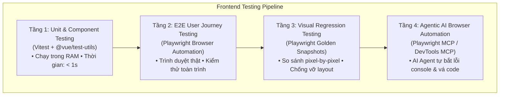

# 06.6. Hướng Dẫn Tích Hợp & Vận Hành Kiểm Thử Tự Động 4 Tầng Frontend

> **Tài liệu tham chiếu:** [05.frontend-verification-and-qa-checklist.md](05.frontend-verification-and-qa-checklist.md)  
> **Nguyên tắc vận hành:** Tự động hóa tối đa, phát hiện lỗi vỡ layout và lỗi nghiệp vụ ngay tại môi trường phát triển cục bộ trước khi đẩy mã nguồn lên kho lưu trữ.

---

## 1. Tổng Quan Kiến Trúc Kiểm Thử 4 Tầng (Testing Pyramid)



---

## 2. Chi Tiết Thực Thi Từng Tầng Kiểm Thử

### 2.1. Tầng 1: Unit & Component Testing (`Vitest`)

- **Công cụ:** `vitest`, `@vue/test-utils`, `happy-dom`.
- **Cấu hình:** `frontend/vite.config.js` đã tích hợp cấu hình `test: { environment: 'happy-dom' }`.
- **Lệnh thực thi:**
  ```bash
  cd frontend
  npm run test:unit
  ```
- **Quy chuẩn viết test:**
  - Mọi composable chứa logic tính toán thời gian, state chuyển đổi hoặc phân quyền đều bắt buộc có file test tương ứng tại `src/**/__tests__/*.spec.js`.
  - Mọi atomic component có trạng thái loading, disabled, hoặc variant đều phải kiểm thử render và trigger event.

---

### 2.2. Tầng 2: E2E User Journey Testing (`Playwright`)

- **Công cụ:** `@playwright/test`.
- **Mục tiêu:** Giả lập thao tác người dùng thật trên trình duyệt Chromium/WebKit/Firefox.
- **Kịch bản chuẩn Luồng Đặt Vé Khách Hàng (`tests/e2e/booking-flow.spec.js`):**
  ```javascript
  import { test, expect } from '@playwright/test';

  test('Khách hàng tìm chuyến, chọn ghế 2 tầng và tiến hành đặt vé', async ({ page }) => {
    // 1. Truy cập trang chủ
    await page.goto('http://localhost:5173/');
    
    // 2. Điền điểm đi, điểm đến và tìm kiếm
    await page.fill('[data-testid="input-departure"]', 'Đà Nẵng');
    await page.fill('[data-testid="input-destination"]', 'Nha Trang');
    await page.click('[data-testid="btn-search-trips"]');
    
    // 3. Chọn chuyến xe đầu tiên
    await page.waitForSelector('[data-testid="trip-card"]');
    await page.click('[data-testid="btn-select-trip-first"]');
    
    // 4. Chọn ghế trên sơ đồ 2 tầng (Ghế A01 tầng dưới)
    await page.click('[data-testid="seat-A01"]');
    await expect(page.locator('[data-testid="selected-seats-count"]')).toHaveText('1 ghế');
    
    // 5. Kiểm tra đồng hồ giữ chỗ 10 phút kích hoạt
    await expect(page.locator('[data-testid="hold-countdown"]')).toBeVisible();
  });
  ```
- **Lệnh thực thi:**
  ```bash
  cd frontend
  npx playwright test
  ```

---

### 2.3. Tầng 3: Visual Regression Testing (`Golden Snapshots`)

- **Công cụ:** Tính năng so sánh ảnh chụp của Playwright (`toHaveScreenshot`).
- **Nguyên lý hoạt động:** Chụp ảnh màn hình giao diện thực tế và so sánh với ảnh chuẩn (Golden Snapshot) đã lưu trước đó. Nếu độ lệch vượt quá `maxDiffPixelRatio: 0.01` (1%), bài test sẽ thất bại và xuất ra hình ảnh so sánh trực quan (Diff Image).
- **Mẫu kiểm thử chống vỡ Sơ đồ ghế & Dashboard:**
  ```javascript
  test('Sơ đồ ghế 2 tầng hiển thị chuẩn không bị lệch layout', async ({ page }) => {
    await page.goto('http://localhost:5173/trips/1/seats');
    await page.waitForSelector('[data-testid="seat-map-container"]');
    
    // So sánh ảnh chụp component với snapshot chuẩn
    await expect(page.locator('[data-testid="seat-map-container"]')).toHaveScreenshot('seat-map-2deck.png', {
      maxDiffPixelRatio: 0.01,
    });
  });
  ```
- **Lệnh cập nhật ảnh chuẩn khi có thay đổi thiết kế:**
  ```bash
  cd frontend
  npx playwright test --update-snapshots
  ```

---

### 2.4. Tầng 4: Agentic AI Browser Automation (AI-Driven QA)

- **Cơ chế vận hành:** Tận dụng công cụ MCP (Model Context Protocol) hoặc Playwright CLI gắn trực tiếp vào Agent AI Antigravity.
- **Quy trình hoạt động tự động:**
  1. AI Agent mở trình duyệt ngầm truy cập `http://localhost:5173`.
  2. Tự động lắng nghe `page.on('console', msg => ...)` và `page.on('response', res => ...)`.
  3. Nếu phát hiện lỗi JavaScript (Uncaught Exception) hoặc Network call lỗi 500, AI tự động lưu lại stack trace.
  4. AI kích hoạt ngay subagent `root-cause-debugger` để mở tệp mã nguồn tương ứng, sửa lỗi, và chạy lại `npm run test:unit` để đảm bảo hệ thống không bị hồi quy.

---

## 3. Quy Trình Xuất Báo Cáo & Tích Hợp Vào CI/CD

Trước khi kết thúc bất kỳ Phase nào, kỹ sư chạy chuỗi lệnh kiểm định toàn diện:

```bash
# 1. Chạy Unit/Component Tests
npm run test:unit

# 2. Kiểm tra Production Build
npm run build

# 3. Quét rò rỉ mã bí mật
bash /home/vanthanh/.gemini/config/skills/workflow-orchestrator/scripts/pre_commit_secret_scan.sh
```

Kết quả của chuỗi lệnh này là bằng chứng bắt buộc để điền vào `reports/01.progress-ledger.md` và `reports/phase-*/01.qa-acceptance-report.md`.
