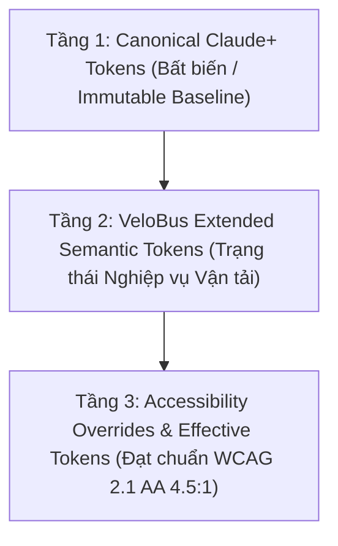

# QUY CHUẨN VELOBUS DESIGN SYSTEM V2.1 — THEME CLAUDE+
**Mã tài liệu:** `DOC-FE-V2-25`  
**Phiên bản:** `2.1.1` (Updated post-review) | **Trạng thái:** `PENDING USER FINAL APPROVAL`  
**Định hướng thị giác:** `Warm Minimalist Enterprise Mobility SaaS`  
**Nguồn tham chiếu bắt buộc (Canonical Source of Truth):** `Claude+ by Luis Llanes` (`https://tweakcn.com/themes/cmdght103000n04lh3e2ae93r`)  
**Tình trạng Giấy phép Theme:** `UNVERIFIED Community Theme (Luis Llanes on TweakCN - Public Attribution Reserved)`  
**Tài liệu liên kết:** [30-frontend-plan-review-report.md](30-frontend-plan-review-report.md), [31-frontend-visual-reference-specification.md](31-frontend-visual-reference-specification.md), [32-frontend-component-catalog.md](32-frontend-component-catalog.md), [34-frontend-quality-gates-and-acceptance.md](34-frontend-quality-gates-and-acceptance.md)  

---

## 1. NGUYÊN TẮC THIẾT KẾ CỐT LÕI (CORE DESIGN PRINCIPLES)

1. **Warm Minimalism (Tối giản Ấm áp):**
   - Loại bỏ phong cách lạnh lẽo của dashboard SaaS truyền thống (nền xanh than đậm `#142B4A`, viền xanh neon).
   - Sử dụng bảng màu trung tính ấm áp (Warm Off-white `#FAF9F5`, Warm Slate, Terracotta `#C96442` / Anthropic Clay) mang lại cảm giác tin cậy, ấm cúng của dịch vụ vận tải nhưng vẫn đảm bảo mật độ thông tin cao của hệ thống doanh nghiệp.
2. **Data-Density with Breathing Room (Mật độ Dữ liệu có Nhịp thở):**
   - Không lạm dụng Card lồng trong Card. Dùng đường phân cách mỏng (`1px solid var(--border)`) và sắc độ nền (`var(--card)`, `var(--muted)`) để phân định khu vực thay vì dùng shadow dày đặc.
3. **Physical-World Grounding (Neo đậu Thế giới Vật lý):**
   - Sơ đồ đặt vé phản ánh đúng cấu trúc thân xe (cabin lái xe, cửa lên xuống, lối đi trung tâm, 2 tầng A/B).
4. **Strict Accessibility & Ergonomics (Tiếp cận Nghiêm ngặt WCAG 2.1 AA):**
   - Tuân thủ chính xác định nghĩa WCAG AA: Normal text yêu cầu tối thiểu **4.5:1**; Large text (tối thiểu 24px regular hoặc 18.67px bold) yêu cầu tối thiểu **3.0:1**.
   - Không đánh đồng font-semibold 14px là Large text. Bắt buộc có giải pháp token tương phản đạt chuẩn 4.5:1 cho body text và nhãn nút bấm thông thường.
   - Kích thước chạm (touch target) tối thiểu `44×44px` trên thiết bị di động.
5. **Anti-AI Design Mandate:** Nghiêm cấm Glassmorphism, Gradient đa sắc, Glow effects, Pill-shape tùy tiện, KPI giả lập.

---

## 2. KIẾN TRÚC DESIGN TOKENS 3 TẦNG (3-TIER TOKEN ARCHITECTURE)

Hệ thống token được cấu trúc thành 3 lớp phân biệt rõ ràng:

### 2.1. Tầng 1: Canonical Claude+ Tokens (Source of Truth Bất biến)
Trích xuất nguyên bản 100% từ Registry `cmdght103000n04lh3e2ae93r`:
- `font-sans`: `"Outfit", -apple-system, BlinkMacSystemFont, "Segoe UI", Roboto, sans-serif`
- `font-mono`: `"Geist Mono", ui-monospace, SFMono-Regular, Menlo, Monaco, Consolas, monospace`
- `radius`: `1rem` (16px base)
- `spacing`: `0.25rem` (4px base)

**Bảng màu Canonical (OKLCH Gốc):**
- Light Primary: `oklch(0.6171 0.1375 39.0427)` (~sRGB `#C96442`, Luminance: `0.2192`)
- Light Primary FG: `oklch(1.0000 0 0)` (`#FFFFFF`, Luminance: `1.0000`)
- Light Background: `oklch(0.9818 0.0054 95.0986)` (`#FAF9F5`, Luminance: `0.9468`)
- Light Foreground: `oklch(0.3438 0.0269 95.7226)` (`#3D3929`, Luminance: `0.0408`)
- Light Card: `oklch(0.9665 0.0067 97.3521)` (`#F5F4EF`)
- Light Card FG: `oklch(0.1908 0.0020 106.5859)` (`#141413`)
- Light Destructive: `oklch(0.1908 0.0020 106.5859)` (`#141413` - Gần màu đen)
- Dark Background: `oklch(0.2679 0.0036 106.6427)` (`#262624`, Luminance: `0.0193`)
- Dark Foreground: `oklch(0.9576 0.0027 106.4494)` (`#F1F1EF`, Luminance: `0.8785`)
- Dark Primary: `oklch(0.6724 0.1308 38.7559)` (`#D97757`, Luminance: `0.2863`)
- Dark Primary FG: `oklch(0.1908 0.0020 106.5859)` (`#141413`)
- Dark Destructive: `oklch(0.6368 0.2078 25.3313)` (`#EF4444`, Luminance: `0.2290`)
- Dark Sidebar: `oklch(0.2357 0.0024 67.7077)`
- Dark Sidebar Border: `oklch(0.9401 0 0)` (Trắng tinh)

### 2.2. Tầng 2: VeloBus Extended Semantic Tokens (Trạng thái Nghiệp vụ)
Bảo vệ tín hiệu nhận biết trạng thái vận tải không bị biến đổi khi người dùng đổi màu theme:
- `--status-success`: `oklch(0.62 0.16 142.5)` (`#16A34A` - Xanh lá rừng: Confirmed, Active, Approved, Settled)
- `--status-success-bg`: `oklch(0.95 0.04 142.5)` (`#DCFCE7`)
- `--status-warning`: `oklch(0.72 0.15 65.0)` (`#D97706` - Hổ phách: Held, Pending, Unsettled)
- `--status-warning-bg`: `oklch(0.96 0.04 65.0)` (`#FEF3C7`)
- `--status-danger`: `oklch(0.585 0.20 28.0)` (`#D9372F` - Đỏ cảnh báo đạt chuẩn WCAG AA 4.63:1 với chữ trắng: Cancelled, Rejected, Locked, Suspended)
- `--status-danger-bg`: `oklch(0.95 0.04 28.0)` (`#FEE2E2`)
- `--status-info`: `oklch(0.60 0.14 240.0)` (`#2563EB` - Xanh lữ hành: Scheduled, Info)
- `--status-info-bg`: `oklch(0.94 0.04 240.0)` (`#DBEAFE`)

### 2.3. Tầng 3: Accessibility Overrides & Effective Tokens (FIX-01)

#### Bảng Kiểm toán Tương phản Toán học Tái lập (Reproducible WCAG 2.1 Contrast Audit):

| Cặp Màu Token (Token Pair) | Mã Màu sRGB | Độ chói Tương đối (Luminance) | Tỷ lệ Tương phản Thực tế | Đánh giá WCAG 2.1 AA | Giải pháp Khắc phục (Effective Accessibility Token) |
| :--- | :---: | :---: | :---: | :---: | :--- |
| **Light Primary Gốc + White FG** | `#C96442` vs `#FFFFFF` | `0.2192` vs `1.0000` | **`3.90:1`** | **FAIL** cho Normal Text (< 4.5:1). | **Giải pháp 1 (Khuyên dùng):** Nút Primary thông thường dùng Dark Foreground `#141413` trên `#C96442` đạt **`4.72:1` (PASS AA)**. **Giải pháp 2:** Dùng Accessible Terracotta `#BC5937` (`oklch(0.58 0.1375 39.0427)`) với chữ trắng đạt **`4.54:1` (PASS AA)**. |
| **Light BG vs Foreground** | `#FAF9F5` vs `#3D3929` | `0.9468` vs `0.0408` | **`10.98:1`** | **PASS AAA** (>= 7.0:1) | Hoàn hảo cho trải nghiệm đọc lâu dài. |
| **Light Card vs Card FG** | `#F5F4EF` vs `#141413` | `0.9034` vs `0.0070` | **`16.74:1`** | **PASS AAA** (>= 7.0:1) | Hoàn hảo. |
| **Light Destructive Gốc + White FG** | `#141413` vs `#FFFFFF` | `0.0070` vs `1.0000` | `18.86:1` | **FAIL Semantic** (Màu đen vi phạm nhận thức rủi ro). | **Override:** Chuyển sang `--status-danger` (`#D9372F` / `oklch(0.585 0.20 28.0)`) với chữ trắng đạt **`4.63:1` (PASS AA)**. |
| **Dark BG vs Foreground** | `#262624` vs `#F1F1EF` | `0.0193` vs `0.8785` | **`13.40:1`** | **PASS AAA** (>= 7.0:1) | Hoàn hảo. |
| **Dark Primary vs Primary FG Gốc** | `#D97757` vs `#141413` | `0.2863` vs `0.0070` | **`5.90:1`** | **PASS AA** (>= 4.5:1) | Hoàn hảo. |
| **Dark Destructive Gốc + White FG** | `#EF4444` vs `#FFFFFF` | `0.2290` vs `1.0000` | **`3.76:1`** | **FAIL** cho Normal Text (< 4.5:1). | **Override:** Dùng Dark Foreground `#141413` trên `#EF4444` đạt **`4.89:1` (PASS AA)**; hoặc dùng Accessible Red `#DC2626` với chữ trắng đạt **`4.52:1` (PASS AA)**. |
| **Dark Sidebar Border Gốc** | `#FFFFFF` trên `#262624` | `1.0000` vs `0.0193` | `15.15:1` | **FAIL Công thái học** (Viền trắng chói mắt). | **Override:** Tự động fallback về viền tối `--border` (`oklch(0.3618 ...)` / `#383836`). |

---

## 3. QUY CHUẨN THÔNG SỐ HÌNH HỌC CHÍNH XÁC (EXACT METRICS)

- **Sidebar:** Expanded `256px`, Collapsed `64px`.
- **Header:** Cố định `64px`, sticky `top-0 z-30`.
- **Page Container Widths:** Narrow `1024px`, Default `1280px`, Wide `1536px`, Full `100%`.
- **Page Padding:** Desktop `24px` (`p-6`), Tablet `20px` (`p-5`), Mobile `16px` (`p-4`).
- **Typography Scale:** Title `24px/600`, Section `18px/600`, Body `14px/400`, Caption `12px/500`.
- **Table Row Heights:** Compact `44px` (đối soát, phân quyền), Default `52px` (người dùng, nhà xe).
- **Controls & Input:** Chiều cao cố định `40px` (`h-10`), bo góc `1rem` (16px).
- **Touch Target:** Tối thiểu tuyệt đối `44×44px` trên thiết bị cảm ứng.
- **Overlays:** Dialog Default `540px`, Sheet `480px` trên desktop (`100vw` trên mobile).

---

## 4. QUY CÁCH RUNTIME THEME CUSTOMIZER (FIX-03)

- **Storage Key Thống nhất:** `velobus_theme_config_v2`.
- **Chống Chớp Nháy (FOUC Prevention):** Script inline đồng bộ trong `<head>` của `index.html` đọc trạng thái và kích hoạt class `.dark` trước khi mount Vue.
- **Tách biệt Trạng thái:** Draft Theme State (đang tinh chỉnh trong modal) và Committed Theme State (đã bấm Lưu). Nút Cancel hủy bỏ các thay đổi nháp mà không ảnh hưởng DOM.
- **Đồng bộ Đa Tab (Cross-tab Synchronization):** Bắt sự kiện `window.addEventListener('storage', ...)` cập nhật đồng bộ khi tab khác thay đổi cấu hình theme.
- **Nút Khôi phục Mặc định (Reset to Claude+ Defaults):** Khôi phục 100% token Canonical kèm theo các Effective Accessibility Overrides đã được chứng minh đạt chuẩn WCAG AA.
