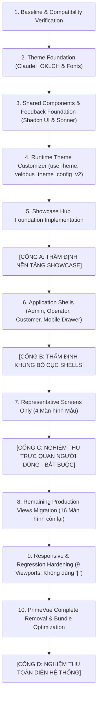

# KẾ HOẠCH TỔNG THỂ TRIỂN KHAI FRONTEND V2.1 (MASTER IMPLEMENTATION PLAN)
**Mã tài liệu:** `DOC-FE-V2-27`  
**Phiên bản:** `2.1.1` (Updated post-review) | **Trạng thái:** `PENDING USER FINAL APPROVAL`  
**Phạm vi:** 13 Phase chuyển đổi có phụ thuộc tuần tự nghiêm ngặt (Strict DAG), phân định 4 Cổng Chất lượng (Gate A - Gate D), chốt chặn Cổng C trước khi di chuyển đại trà, nghiệm thu độc lập từng phase.  
**Tài liệu liên kết:** [30-frontend-plan-review-report.md](30-frontend-plan-review-report.md), [34-frontend-quality-gates-and-acceptance.md](34-frontend-quality-gates-and-acceptance.md)  

---

## 1. SƠ ĐỒ PHỤ THUỘC CHÍNH XÁC (STRICT MIGRATION DAG & GATES — FIX-02)

---

## 2. CHI TIẾT CÁC GIAI ĐOẠN TRIỂN KHAI THEO CHUẨN MỰC

### Giai đoạn 1: Baseline & Compatibility Verification (Scope hiện tại)
- **Mục tiêu:** Xác minh tính tương thích giữa Tailwind CSS v3.4.17, `reka-ui`, `vue-sonner`, `@tanstack/vue-table` qua npm lockfile.
- **Tiêu chuẩn kiểm tra:** `npm run type-check && npm run test:unit && npm run test:e2e && npm run build`.

---

### Giai đoạn 2: Theme Foundation (Scope A)
- **Mục tiêu:** Nhúng toàn bộ Canonical Claude+ CSS, Extended Semantic Tokens và Accessibility Overrides (đạt WCAG AA 4.5:1).
- **Phạm vi tác động:** `frontend/src/assets/main.css`, `frontend/tailwind.config.js`, `frontend/index.html`.
- **Nhiệm vụ:**
  1. Nhúng font chữ Outfit và Geist Mono vào `index.html`.
  2. Bổ sung script inline chống FOUC trong `<head>`.
  3. Cấu hình biến CSS OKLCH và CSS Variable Bridging trong `tailwind.config.js`.

---

### Giai đoạn 3: Shared Components & Feedback Foundation (Scope B & C)
- **Mục tiêu:** Triển khai các Shadcn UI primitives và hệ thống Feedback tập trung (`src/components/ui/`).
- **Phạm vi:** `Button`, `Input`, `PasswordInput`, `Textarea`, `Select`, `Combobox`, `Checkbox`, `RadioGroup`, `Switch`, `Card`, `Table`, `Pagination`, `Badge`, `StatusBadge`, `Tabs`, `DropdownMenu`, `Tooltip`, `Popover`, `Dialog`, `AlertDialog`, `Sheet`, `Alert`, `Sonner Toast`, `Skeleton`, `Spinner`, `EmptyState`, `ErrorState`.
- **Nhiệm vụ:**
  1. Cài đặt các thư viện phụ thuộc qua `npm`: `reka-ui`, `clsx`, `tailwind-merge`, `class-variance-authority`, `vue-sonner`, `@tanstack/vue-table`.
  2. Đặt `<Toaster richColors position="top-right" />` vào `App.vue`.
  3. Chuẩn hóa `AlertDialog` theo Confirmation Policy Matrix.

---

### Giai đoạn 4: Runtime Theme Customizer (Scope D — FIX-03)
- **Mục tiêu:** Hoàn thiện bộ điều khiển tùy biến giao diện runtime `ThemeCustomizer.vue` và composable `useTheme.ts`.
- **Đặc tả tính năng:**
  - Storage key: `velobus_theme_config_v2`.
  - Hỗ trợ Light / Dark / System Mode (lắng nghe `matchMedia`).
  - Bộ chọn Primary Accent (Claude+ Terracotta, Ocean, Forest, Violet, Custom Picker).
  - Tùy chỉnh bo góc: 0.5rem, 0.75rem, 1.0rem, 1.25rem.
  - Tùy chỉnh mật độ: Compact, Default, Comfortable.
  - Tách biệt Draft State (đang chọn) và Committed State (đã bấm Lưu). Nút Cancel hủy bỏ nháp.
  - Nút "Khôi phục mặc định Claude+" đưa về nguyên bản 100%.

---

### Giai đoạn 5: Showcase Hub Foundation Implementation (Scope E — FIX-04)
- **Mục tiêu:** Kích hoạt lại Showcase Hub tại `/showcase` làm Design System Playground chính thức phục vụ nghiệm thu Cổng A.
- **Phân nhóm hiển thị đầy đủ:**
  - Design Overview & Palette (Light/Dark live preview).
  - Typography & Spacing scale.
  - Button Variants & Interaction States (Hover, Active, Disabled, Loading).
  - Form Controls (Input, Password toggle, Select, Combobox, Checkbox, Radio, Switch).
  - DataTable & Responsive Preview.
  - Cards, Badges & Status Indicators.
  - Overlays (Dialog, AlertDialog confirmation, Sheet 480px / mobile full-width).
  - Feedback Playground (Success/Error/Warning/Info Toasts, Alerts, Skeletons, Spinners).
  - Theme Customizer Live Integration.
- **Chốt chặn An toàn:** Chỉ dùng Mock Fixtures biệt lập; không bypass auth; không mở quyền quản trị thật.

---

### CỔNG A: Thẩm định Nền tảng Showcase (Foundation Gate)
- **Nghiệm thu:** Kiểm tra tương phản WCAG 2.1 AA, kiểm tra tính năng Customizer, 100% component có trạng thái tương tác hoàn chỉnh trên Showcase Hub.

---

### Giai đoạn 6 & CỔNG B: Application Shells & Layout Approval
- Triển khai `AdminLayout.vue`, `OperatorLayout.vue`, `CustomerLayout.vue`, `DashboardLayout.vue`.
- Đạt Cổng B: Responsive navigation, Sidebar 256px / 64px, Header 64px, Drawer off-canvas.

---

### Giai đoạn 7 & CỔNG C: Representative Screens & User Visual Approval
- **4 Màn hình Mẫu:** `AdminDashboardView`, `OperatorDashboardView`, `HomeView`, `SeatSelectionView` / `AdminUsersBookingsView`.
- **CHỐT CHẶN BẮT BUỘC:** Người dùng trực tiếp trải nghiệm và phê duyệt trực quan tại Cổng C mới được phép chuyển sang Giai đoạn 8.

---

### Giai đoạn 8, 9, 10 & CỔNG D: Bulk Migration, Hardening & Final Gate
- Di chuyển 16 màn hình còn lại theo 3 batch (Admin -> Operator -> Customer).
- Kiểm định tràn viền 9 viewports bằng Playwright (lệnh chạy độc lập, không dùng `||`).
- Gỡ bỏ hoàn toàn PrimeVue khỏi bundle.
- Đạt Cổng D: Full Migration PASS.
