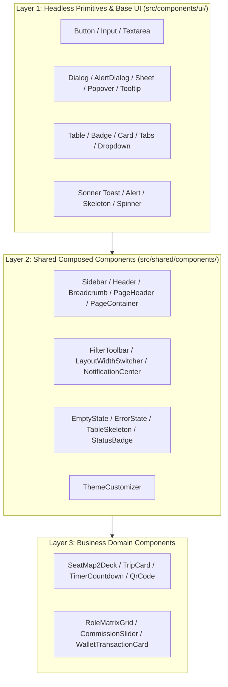

# DANH MỤC THÀNH PHẦN LINH KIỆN TOÀN DIỆN (FULL COMPONENT CATALOG)
**Mã tài liệu:** `DOC-FE-V2-32`  
**Phiên bản:** `2.1.0` | **Trạng thái:** `APPROVED AS SPECIFICATION`  
**Phạm vi:** Đặc tả chi tiết 39 Components thuộc 3 phân nhóm: UI Primitives (`src/components/ui/`), Shared Composed Components (`src/shared/components/`) và Business Domain Components.

---

## 1. PHÂN LOẠI KIẾN TRÚC COMPONENT

---

## 2. ĐẶC TẢ CHI TIẾT CÁC ATOMIC UI PRIMITIVES (`src/components/ui/`)

### 2.1. Button (`src/components/ui/button/`)
- **Mục đích:** Thành phần kích hoạt hành động chính/phụ trong toàn bộ ứng dụng.
- **Biến thể (Variants):**
  - `default`: Nền `var(--primary)` (Terracotta `#C96442`), chữ `var(--primary-foreground)` (Trắng), hover `opacity-90`.
  - `secondary`: Nền `var(--secondary)`, chữ `var(--secondary-foreground)`.
  - `outline`: Viền `1px solid var(--border)`, nền trong suốt, hover `bg-accent`.
  - `ghost`: Không viền, hover `bg-accent text-accent-foreground`.
  - `destructive`: Nền `var(--status-danger)` (Đỏ gạch cảnh báo `#DC2626`), chữ trắng.
  - `link`: Gạch chân, không nền, màu `var(--primary)`.
- **Kích thước (Sizes):** `sm` (h-9 px-3 text-xs), `default` (h-10 px-4 text-sm), `lg` (h-11 px-6 text-base), `icon` (h-10 w-10).
- **Trạng thái (States):**
  - *Default:* Rõ ràng, tương phản.
  - *Hover:* Đổi sắc độ nền nhẹ, transition 150ms.
  - *Focus:* Hiển thị viền nét ngoài `2px solid var(--ring)` kèm `outline-offset-2`.
  - *Disabled:* `opacity-50 pointer-events-none cursor-not-allowed`.
  - *Loading:* Tự động vô hiệu hóa click, ẩn icon chính và hiển thị Lucide `Loader2` quay tròn kèm nhãn đang xử lý.
- **Tiếp cận (Accessibility):** Thẻ `<button type="button|submit">`, hỗ trợ phím Space/Enter kích hoạt, aria-disabled khi loading.
- **Kiểm thử:** Unit test kiểm tra kích hoạt event `click`, vô hiệu hóa khi `disabled` hoặc `loading`.

### 2.2. Input & Password Input (`src/components/ui/input/`)
- **Mục đích:** Nhập dữ liệu văn bản, email, số điện thoại, mật khẩu.
- **Kích thước:** Chiều cao cố định `40px` (`h-10`), font chữ `14px` (`text-sm`), padding `px-3 py-2`.
- **Biến thể Password Input:** Tích hợp nút toggle icon Lucide `Eye` / `EyeOff` ở góc phải, chuyển đổi thuộc tính `type="password"` sang `type="text"`.
- **Trạng thái:**
  - *Default:* Viền `1px solid var(--input)`, nền `var(--background)`.
  - *Focus:* Viền chuyển sang `var(--ring)`, shadow nhẹ.
  - *Invalid (Lỗi):* Viền chuyển sang `var(--status-danger)` kèm thông báo lỗi phía dưới.
  - *Disabled:* Nền xám mờ `var(--muted)`, chữ nhạt `var(--muted-foreground)`.
- **Tiếp cận:** Bắt buộc liên kết `id` với thẻ `<label for="...">`, hỗ trợ `aria-invalid` và `aria-describedby` trỏ tới ID của thông báo lỗi.

### 2.3. DataTable (`src/components/ui/table/`)
- **Mục đích:** Hiển thị danh sách dữ liệu có cấu trúc phân trang, lọc và sắp xếp dựa trên TanStack Vue Table.
- **Cấu trúc:** Gồm các sub-components: `Table`, `TableHeader`, `TableBody`, `TableFooter`, `TableHead`, `TableRow`, `TableCell`.
- **Chiều cao dòng (Row Heights):**
  - `compact`: Cố định `44px` (áp dụng cho bảng đối soát, bảng phân quyền 26 APIs).
  - `default`: Cố định `52px` (áp dụng cho bảng người dùng, nhà xe, chuyến đi).
- **Hành vi Responsive:**
  - Desktop: Render đầy đủ cột, hỗ trợ sắp xếp sorting qua header click.
  - Mobile: Tự động chuyển sang chiến lược phù hợp theo cấu hình (xem Mục 4 bên dưới).
- **Trạng thái:** Tích hợp sẵn `TableSkeleton` khi tải dữ liệu và `EmptyState` khi không có bản ghi nào.

### 2.4. Dialog & AlertDialog (`src/components/ui/dialog/`, `alert-dialog/`)
- **Mục đích:**
  - `Dialog`: Nhập liệu biểu mẫu phức tạp (Đổi mật khẩu, tạo chuyến xe).
  - `AlertDialog`: Hộp thoại xác nhận bắt buộc cho hành động rủi ro cao (Khóa tài khoản, Duyệt giải ngân Escrow, Hủy chuyến).
- **Đặc tính kỹ thuật:** Xây dựng trên Reka UI Primitives (`DialogRoot`, `AlertDialogRoot`).
- **Focus Trap:** Tự động giữ focus bàn phím bên trong modal, khóa cuộn trang (`body overflow: hidden`), đóng khi bấm phím ESC (nếu không đang xử lý tiến trình gửi dữ liệu).
- **Backdrop:** Nền tối mờ nhẹ `bg-black/40 backdrop-blur-xs`, click ngoài đóng modal (AlertDialog chặn click ngoài để tránh hủy nhầm).

### 2.5. Sheet / Drawer (`src/components/ui/sheet/`)
- **Mục đích:** Ngăn kéo trượt từ cạnh phải màn hình phục vụ xem chi tiết hồ sơ hoặc form chỉnh sửa nhanh mà không làm mất ngữ cảnh bảng bên dưới.
- **Kích thước:**
  - Desktop: Chiều rộng cố định `480px` (`w-[480px]`).
  - Mobile (`< 640px`): Tự động bung toàn màn hình `100vw` có header cố định và nút đóng rõ ràng.
- **Cấu trúc:** `SheetHeader`, `SheetBody` (cuộn dọc độc lập), `SheetFooter` (chứa nút Hủy và Lưu cố định dưới đáy).

### 2.6. StatusBadge (`src/components/ui/badge/`)
- **Mục đích:** Hiển thị trực quan trạng thái thực tế của vé, tài khoản, nhà xe, giao dịch.
- **Bảng ánh xạ Semantic Trạng thái:**
  - `ACTIVE`, `CONFIRMED`, `APPROVED`, `SUCCESS`, `SETTLED`: Nền `var(--status-success-bg)`, chữ `var(--status-success)`, chấm tròn xanh lá.
  - `HELD`, `PENDING`, `PENDING_APPROVAL`, `UNSETTLED`: Nền `var(--status-warning-bg)`, chữ `var(--status-warning)`, chấm tròn hổ phách.
  - `CANCELLED`, `REJECTED`, `SUSPENDED`, `LOCKED`: Nền `var(--status-danger-bg)`, chữ `var(--status-danger)`, chấm tròn đỏ gạch.
  - `SCHEDULED`, `INFO`: Nền `var(--status-info-bg)`, chữ `var(--status-info)`, chấm tròn xanh dương.
  - `EXPIRED`, `REFUNDED`: Nền `var(--muted)`, chữ `var(--muted-foreground)`, chấm tròn xám.

### 2.7. Vue Sonner Toast (`src/components/ui/sonner/`)
- **Mục đích:** Hệ thống thông báo kết quả thao tác tập trung toàn hệ thống.
- **Đặc tính:**
  - Vị trí cố định: Góc trên bên phải (`top-right`) trên Desktop, góc trên chính giữa (`top-center`) trên Mobile.
  - Thời lượng hiển thị: Mặc định `4000ms` (tự động đóng).
  - Tích hợp icon: `CheckCircle2` (Success), `AlertCircle` (Error), `AlertTriangle` (Warning), `Info` (Info).
  - Stacking: Tự động xếp chồng tối đa 3 toasts cùng lúc. Hỗ trợ thao tác vuốt để tắt (swipe to dismiss).

---

## 3. ĐẶC TẢ THÀNH PHẦN DÙNG CHUNG (SHARED COMPOSED COMPONENTS)

### 3.1. PageHeader (`src/shared/components/PageHeader.vue`)
- **Props:** `title` (bắt buộc), `subtitle` (tùy chọn), `breadcrumbs` (danh sách `{ label, to }`).
- **Layout:** Cấu trúc 2 cột linh hoạt. Bên trái chứa breadcrumbs phân cấp và tiêu đề trang; bên phải là slot `actions` chứa các nút hành động chính (Tạo mới, Xuất file).
- **Responsive:** Trên mobile tự động xếp chồng theo chiều dọc (`flex-col gap-3`).

### 3.2. FilterToolbar (`src/shared/components/FilterToolbar.vue`)
- **Mục đích:** Thanh công cụ tìm kiếm và lọc dữ liệu phía trên các bảng.
- **Thành phần:** Ô tìm kiếm văn bản với cơ chế debounce 300ms, dropdown chọn trạng thái, bộ lọc ngày tháng và nút xóa bộ lọc (Reset).
- **Hành vi:** Tự động co giãn theo hàng (`flex-wrap gap-3`), không phát sinh thanh cuộn ngang.

### 3.3. NotificationCenter (`src/shared/components/NotificationCenter.vue`)
- **Mục đích:** Hiển thị chuông thông báo và danh sách thông báo real-time.
- **Thành phần:** Nút icon chuông Lucide `Bell` kèm badge đếm số lượng chưa đọc, Popover danh sách thông báo, tab lọc (Tất cả / Chưa đọc), nút "Đánh dấu đã đọc tất cả".

### 3.4. ThemeCustomizer (`src/shared/components/ThemeCustomizer.vue`)
- **Mục đích:** Bảng điều khiển cài đặt giao diện runtime.
- **Tính năng:**
  - Chuyển đổi Mode: Light / Dark / System.
  - Bảng chọn Primary Accent (Claude+ Terracotta, Ocean, Forest, Violet).
  - Chọn độ bo góc Radius (0.5rem, 0.75rem, 1.0rem, 1.25rem).
  - Chọn mật độ giao diện: Compact / Default.
  - Nút "Khôi phục mặc định Claude+" (Reset to Defaults).

---

## 4. CHIẾN LƯỢC ĐÁP ỨNG CHO CÁC BẢNG DỮ LIỆU (DATATABLE RESPONSIVE STRATEGIES)

Không áp dụng một quy tắc gộp duy nhất cho tất cả các bảng. Hệ thống phân định 6 chiến lược:

| Chiến lược Bảng | Đặc điểm Kỹ thuật | Màn hình Áp dụng | Hành vi trên Mobile (`< 768px`) |
| :--- | :--- | :--- | :--- |
| **Strategy 1: Priority Column Table** | Đánh số thứ tự ưu tiên cho từng cột. Ẩn dần các cột phụ (P3, P2) khi màn hình thu hẹp, chỉ giữ cột cốt lõi (P1). | `AdminOperatorsView`, `AdminWithdrawalsView`, `OperatorFleetView` | Hiển thị 3 cột chính + Icon mở rộng xem chi tiết các trường ẩn. |
| **Strategy 2: Mobile List Card** | Chuyển đổi hoàn toàn cấu trúc thẻ bảng `<table>` sang danh sách các Card độc lập. | `MyBookingsView`, `AdminBannersView`, `OperatorBannersView` | Mỗi bản ghi là 1 Card chứa thông tin tóm tắt và nút thao tác trực tiếp. |
| **Strategy 3: Horizontally Scrollable Table** | Cho phép thanh cuộn ngang nội bộ **bên trong container bảng**, cố định 2 cột đầu (Mã, Tên) và cột cuối (Hành động). | `AdminDashboardView` (Bảng đối soát giao dịch) | Khóa cuộn ngang toàn trang, bảng có thanh cuộn mượt mà có chỉ báo bóng mờ. |
| **Strategy 4: Responsive Permission Matrix** | Ma trận phân quyền 7 Modules × 26 APIs. | `AdminUsersBookingsView` (Tab Roles) | Chuyển sang dạng Accordion phân cấp theo từng Module; bên trong mỗi Module là danh sách Toggle Switch cho từng quyền API. |
| **Strategy 5: Master-Detail Layout** | Chia đôi màn hình (Bên trái: Danh bạ đối tượng, Bên phải: Chi tiết đối tượng được chọn). | `AdminSettingsView` (Bến xe & Tuyến đường) | Trên mobile tự động chuyển thành quy trình 2 bước: Danh sách -> Nhấp vào chuyển sang màn hình con. |
| **Strategy 6: Standard Responsive Table** | Bảng đơn giản ít cột (dưới 5 cột). | `UserProfileView` (Lịch sử đăng nhập) | Tự động co giãn theo tỷ lệ phần trăm (fluid layout). |
