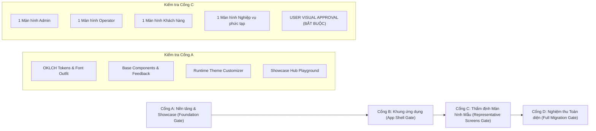

# HỆ THỐNG CỔNG CHẤT LƯỢNG 4 CẤP & TIÊU CHÍ NGHIỆM THU (MULTI-TIERED QUALITY GATES & ACCEPTANCE)
**Mã tài liệu:** `DOC-FE-V2-34`  
**Phiên bản:** `2.1.1` (Updated post-review) | **Trạng thái:** `PENDING USER FINAL APPROVAL`  
**Mục tiêu:** Cưỡng chế quy trình nghiệm thu phân tầng nghiêm ngặt (Gate A -> Gate B -> Gate C -> Gate D), tuyệt đối không di chuyển đại trà trước khi đạt Gate C.  
**Tài liệu liên kết:** [27-frontend-implementation-master-plan.md](27-frontend-implementation-master-plan.md), [30-frontend-plan-review-report.md](30-frontend-plan-review-report.md)  

---

## 1. SƠ ĐỒ CHUYỂN TIẾP CÁC CỔNG CHẤT LƯỢNG (FIX-02)

---

## 2. TIÊU CHÍ CHI TIẾT CỦA TỪNG CỔNG CHẤT LƯỢNG

### 2.1. Cổng A — Nền tảng & Showcase Hub (Foundation Gate — Scope Hiện tại)
- **Mục tiêu:** Kiểm định toàn bộ hệ thống Design Tokens, Typography, Headless Primitives, Centralized Feedback, Runtime Theme Customizer và Showcase Hub Playground.
- **Tiêu chí Đạt (Pass Criteria):**
  1. *Token Integrity & Contrast Audit:* Toàn bộ biến CSS OKLCH của Claude+ được cấu hình chính xác qua CSS Variable Bridging; các cặp màu văn bản và controls đạt chuẩn WCAG 2.1 AA (>= 4.5:1 cho text thường, >= 3.0:1 cho controls/large text).
  2. *Shadcn UI Base Primitives:* 27+ component cơ sở (`Button`, `Input`, `Dialog`, `AlertDialog`, `Sheet`, `Badge`, `Sonner`, `Table`, v.v.) hoạt động độc lập và có unit tests.
  3. *Centralized Feedback:* Vue Sonner hoạt động chính xác, `AlertDialog` tuân thủ Confirmation Policy Matrix.
  4. *Runtime Theme Customizer:* Hoạt động đầy đủ (Light/Dark/System, màu sắc, bo góc, density, reset to defaults, chống FOUC).
  5. *Showcase Hub Playground:* Kích hoạt tại `/showcase`, hiển thị đầy đủ các khối component, interaction states và live theme preview.
  6. *Kiểm tra Tự động:* `npm run type-check && npm run test:unit && npm run build`.

### 2.2. Cổng B — Khung Ứng dụng & Điều hướng (Application Shell Gate)
- **Mục tiêu:** Kiểm định các khung layout dùng chung cho từng phân hệ (`AdminLayout`, `OperatorLayout`, `CustomerLayout`).
- **Tiêu chí:** Sidebar 256px mở rộng, 64px thu gọn; Header 64px sticky; drawer mobile off-canvas; breadcrumbs; Role Preview Banner.

### 2.3. Cổng C — Thẩm định Màn hình Đại diện (Representative Screens Gate)
- **Mục tiêu:** Thẩm định thực tế chất lượng trên 4 màn hình mẫu trước khi cho phép di chuyển 16 màn hình còn lại.
- **Danh sách 4 Màn hình Mẫu:**
  1. *Admin:* `AdminDashboardView.vue` (Bố cục 4 KPIs, bảng đối soát giao dịch).
  2. *Operator:* `OperatorDashboardView.vue` (Ví ký quỹ Escrow, biểu đồ doanh thu).
  3. *Khách hàng:* `HomeView.vue` (Hero Search Box trung tâm, nút hoán đổi 1-click).
  4. *Nghiệp vụ phức tạp:* `SeatSelectionView.vue` (Sơ đồ xe 2 tầng) HOẶC `AdminUsersBookingsView.vue` (Phân quyền 26 APIs).
- **CHỐT CHẶN BẮT BUỘC:** **CẦN SỰ PHÊ DUYỆT TRỰC QUAN CHÍNH THỨC CỦA NGƯỜI DÙNG TẠI CỔNG C** mới được phép kích hoạt Giai đoạn 8 (Bulk Migration).

### 2.4. Cổng D — Nghiệm thu Hoàn tất Chuyển đổi (Full Migration Gate)
- **Tiêu chí:**
  1. Toàn bộ 18 views sản xuất + 2 system views hoàn tất chuyển đổi.
  2. Bảo toàn 100% Feature Parity, API Contract Envelope `ApiResponse<T>`, và RBAC 26 API Permissions.
  3. 100% màn hình đạt `scrollWidth <= innerWidth` trên 9 viewports chuẩn (Playwright test chạy độc lập, không dùng `||`).
  4. Gỡ bỏ hoàn toàn mọi gói PrimeVue và font PrimeIcons tĩnh khỏi bundle.
  5. `npm run type-check && npm run test:unit && npm run test:e2e && npm run build` (100% xanh).
