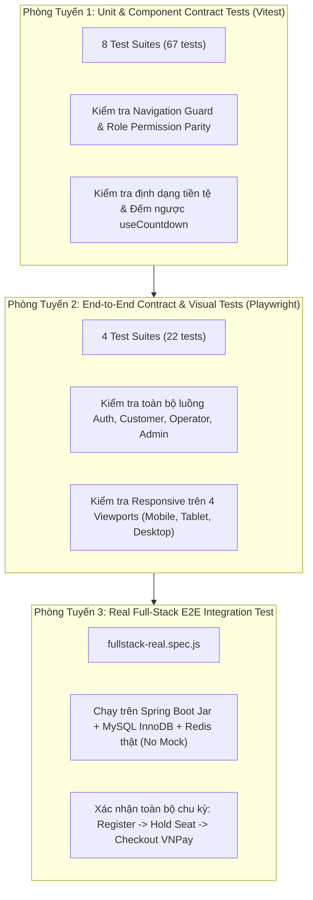

# 10 – Đánh Giá An Ninh & Kiểm Soát Nguy Cơ Regression (Security & Regression Assessment)

> **Mã tài liệu:** `FE-V2-SEC-10`  
> **Thời điểm rà soát:** 25/11/2026  
> **Mục tiêu:** Bảo toàn 100% các cơ chế bảo mật và tính đúng đắn nghiệp vụ đã được nghiệm thu qua các đợt review trước đây.

---

## 1. Danh Mục Các Cơ Chế Bảo Mật Bắt Buộc Phải Bảo Toàn

| Mã cơ chế | Mô tả cơ chế bảo mật | Tệp nguồn phụ trách | Rủi ro khi Refactor V2 | Biện pháp bảo vệ |
| :--- | :--- | :--- | :--- | :--- |
| **FE-SEC-001** | **Fail-Closed Sidebar Navigation:** Không bao giờ hiển thị menu quản trị khi chưa xác thực hoặc không có quyền. | `DashboardLayout.vue`, `useAuthStore` | Khi tách routes mới bị lộ link menu cho user không đủ quyền. | Định nghĩa rõ mảng `requiredPermissions` cho từng route con, lọc menu bằng `auth.hasAnyPermission()`. |
| **FE-SEC-002** | **Profile & Permission Synchronization:** Tự động gọi `GET /api/v1/auth/me` để đồng bộ lại quyền khi tải trang quản trị. | `DashboardLayout.vue` | Bỏ sót hook đồng bộ làm lệch quyền lưu trong cache. | Giữ nguyên hook `onMounted` trong `DashboardLayout` và gọi `auth.refreshProfile()`. |
| **FE-SEC-003** | **Self-Lock Protection:** Không cho phép Admin tự khóa tài khoản của chính mình (`isSelf === true`). | `AdminUsersView.vue` | Quên kiểm tra `isSelf` khi tách file mới. | Mang toàn bộ điều kiện `user.username === auth.user?.username` sang view mới. |
| **FE-SEC-004** | **Client-Side JWT Expiration Check:** Kiểm tra hạn token `exp` ngay tại client trước khi gửi request. | `httpClient.ts` | Khi chuyển sang TypeScript làm sai hàm decode base64 JWT. | Viết Unit Test kiểm tra chặt chẽ `isJwtTokenExpired(token)`. |
| **FE-SEC-005** | **Memory-Only Role Preview:** Trạng thái xem thử giao diện chỉ lưu trên RAM, chặn toàn bộ HTTP POST/PUT/DELETE. | `httpClient.ts`, `useAuthStore` | Đổi store làm rò rỉ preview role vào LocalStorage. | Duy trì biến in-memory `activePreviewRoleCode`, chặn mọi request thay đổi dữ liệu tới `/admin/*`. |
| **FE-SEC-006** | **Nginx HTTP Security Headers:** Đảm bảo đủ các header `nosniff`, `SAMEORIGIN`, CSP. | `frontend/nginx.conf` | Không tác động tới file Nginx. | Giữ nguyên cấu hình Nginx Production. |
| **BE-SEC-007** | **Fixed-Expiry Token:** Endpoint `/auth/me` không bao giờ cấp lại token mới. | `AuthServiceImpl.java`, `auth/store.ts` | Client tự động gia hạn token trái phép. | Không bao giờ cập nhật lại `accessToken` từ response của `/auth/me`. |
| **BE-CON-001** | **Seat Locking & Concurrency:** Khóa ghế vật lý trên MySQL và Redis, đếm ngược 10 phút. | `SeatMap2Deck.vue`, `useCountdown.ts` | Đồng hồ đếm ngược bị lệch thời gian với Redis. | Lấy thời điểm `holdExpiresAt` trực tiếp từ phản hồi của API Backend. |

---

## 2. Chiến Lược Kiểm Thử Ngăn Chặn Regression (Regression Test Strategy)

Để đảm bảo quá trình hiện đại hóa giao diện không làm gãy các tính năng hiện hữu, bộ kiểm thử sẽ được chia làm 3 phòng tuyến:

- **Tiêu chuẩn nghiệm thu:** Mọi thay đổi mã nguồn sau mỗi Phase bắt buộc phải vượt qua:
  1. `npm run test:unit` $\to$ **100% PASS**.
  2. `npm run test:e2e` $\to$ **100% PASS** (22/22 tests).
  3. `npm run build` $\to$ **SUCCESS** (Không có bất kỳ cảnh báo hoặc lỗi type-check).
