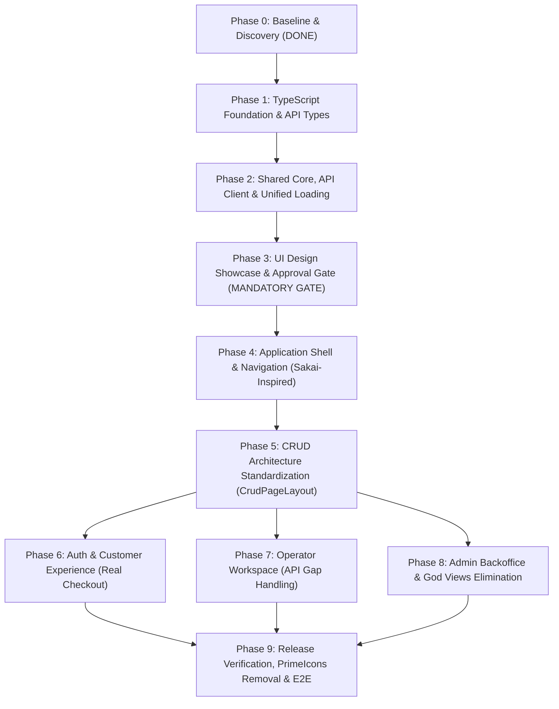

# 12 – Kế Hoạch Tổng Thể Hiện Đại Hóa Frontend V2 (Modernization Master Plan)

> **Mã kế hoạch:** `FE-V2-MASTER-PLAN`  
> **Phiên bản:** `2.1.0` (Refined & Re-Reviewed per REV-V2-001 $\to$ REV-V2-008)  
> **Thời điểm lập:** 25/11/2026  
> **Tiếp cận:** Phân chia thành **10 Phases tuần tự theo chuỗi phụ thuộc kỹ thuật (DAG)**, kiểm soát chặt chẽ rủi ro regression và gắn kết các Quality Gates bắt buộc.

---

## 1. Bản Đồ Tổng Thể Các Giai Đoạn (Master Dependency DAG)

---

## 2. Chi Tiết Từng Giai Đoạn Thực Hiện

### Phase 0: Baseline & Discovery (ĐÃ HOÀN TẤT)
- **Mục tiêu:** Kiểm kê kho mã nguồn, xác nhận baseline commit `2659e1c`, kiểm tra 100% test pass (Vitest 67/67, Playwright 22/22) và xuất bộ tài liệu khảo sát vào `docs/frontend-v2/`.
- **Ràng buộc:** Không chỉnh sửa source code. Dừng tại Approval Gate.

---

### Phase 1: TypeScript Foundation & Type Architecture (Độ phức tạp: Medium)
- **Mục tiêu:** Thiết lập hạ tầng TypeScript nghiêm ngặt (`strict: true`), cài đặt `typescript`, `vue-tsc`, `@types/node`.
- **Phạm vi (Scope):**
  - Cấu hình `tsconfig.json` chuẩn bundler (`strict: true`, `allowJs: true`, `noEmit: true`).
  - Xây dựng thư mục `src/types/` đồng bộ 100% với Backend DTOs (tham chiếu [16-api-contract-matrix.md](file:///home/vanthanh/Ind-Project/Java/ticket-booking/docs/frontend-v2/16-api-contract-matrix.md)):
    - `api.ts`: Hợp đồng `ApiResponse<T>` (`code?: string | null`, `timestamp: string`), `ApiPageResponse<T>` (`hasNext: boolean`, `hasPrevious: boolean`), `ApiError`.
    - `auth.ts`: `UserProfile`, `UserRole = 'ROLE_CUSTOMER' | 'ROLE_OPERATOR' | 'ROLE_ADMIN'`, `LoginCredentials`.
    - `booking.ts`: `TripSummaryDto`, `TripDetailDto`, `SeatDto`, `BookingHoldRequest`, `PaymentInitResponse`.
    - `partner.ts`: `PartnerWalletDto`, `VehicleDto`, `DriverDto`, `WithdrawalDto`.
    - `admin.ts`: `AdminUserDto`, `SystemRoleDto`, `SystemSettingsDto`, `StationDto`.
    - `rbac.ts`: 26 mã quyền từ Backend catalog, `PermissionCatalogModule`.
  - Bổ sung `type-check` script vào `package.json` và CI workflow.
- **Tiêu chí nghiệm thu (DoD):** `npm run type-check` chạy thành công không có lỗi type nào trong thư mục `src/types/`.

---

### Phase 2: Shared Core, API Client & Unified Loading System (Độ phức tạp: Medium)
- **Mục tiêu:** Di chuyển tầng hạ tầng dùng chung sang TypeScript và tích hợp hệ thống Loading phản ánh trạng thái thực.
- **Phạm vi:**
  - Chuyển đổi `src/shared/api/httpClient.ts`, `formatters.ts`, `redirect.ts` sang TypeScript.
  - Tích hợp `AbortController` cho cancelable requests, cơ chế "latest-request-wins", bảo vệ stale response và dọn dẹp khi unmount.
  - Xây dựng component thanh tiến trình điều hướng `src/shared/components/feedback/AppProgressBar.vue` gắn vào router (`router.beforeEach`, `router.afterEach`, `router.onError`).
  - Xây dựng `TableSkeleton.vue`, `SearchLoadingIndicator.vue`, `EmptyState.vue` (có CTA), `ErrorState.vue` (có nút Retry).
  - Tích hợp `AppButton.vue` hỗ trợ prop `:loading="boolean"` tự động chuyển spinner và khóa double submit.
  - Tôn trọng `prefers-reduced-motion` trên toàn bộ animation và skeleton shimmer.
- **Tiêu chí nghiệm thu:** Chuyển route có progress bar chạy trên đỉnh; nút submit hiển thị spinner; xóa toàn bộ `setTimeout` loading giả.

---

### Phase 3: UI Design Showcase & Approval Gate (MANDATORY GATE) (Độ phức tạp: High)
- **Mục tiêu:** Trình diễn 3 hướng phong cách thị giác và phát triển 9 màn hình prototype độc lập để người dùng phê duyệt trước khi áp dụng vào production views (tham chiếu [19-ui-design-direction-proposal.md](file:///home/vanthanh/Ind-Project/Java/ticket-booking/docs/frontend-v2/19-ui-design-direction-proposal.md)).
- **Phạm vi:**
  - Trình bày 3 visual directions:
    1. *Modern Enterprise SaaS (Stripe / Linear)* — Khuyến nghị hàng đầu.
    2. *Premium Mobility & Hospitality (Airbnb Luxe / Uber Black)*.
    3. *Clean Modernist / High-Contrast Monochromatic (Vercel / Raycast)*.
  - Xây dựng 9 màn hình isolated prototype tại nhánh thử nghiệm hoặc route `/showcase/`:
    - Public: Home, Trip Search Results, Seat Selection & Hold, Real Checkout Review.
    - Operator: Dashboard, Fleet & Drivers (tách biệt), Trip Management.
    - Admin: Users & RBAC Matrix, Operations Bookings.
  - Tích hợp `lucide-vue-next` làm thư viện icon chính thức.
- **Tiêu chí nghiệm thu:** Người dùng phê duyệt 1 trong 3 visual directions và xác nhận bố cục 9 màn hình prototype tại Approval Gate.

---

### Phase 4: Application Shell, Navigation & Sakai Integration (Độ phức tạp: High)
- **Mục tiêu:** Nâng cấp Application Shell theo phong cách đã chọn, tái cấu trúc theo chuẩn PrimeVue Sakai.
- **Phạm vi:**
  - Chuẩn hóa Design Tokens tại `assets/main.css` và `VeloBusPreset` trong `main.ts`.
  - Tái cấu trúc `DashboardLayout.vue`:
    - Sidebar cố định 256px, hỗ trợ Collapse mượt mà thu về 76px.
    - Topbar 72px với Breadcrumb tự động ánh xạ theo route hierarchy, thanh tìm kiếm nhanh, Notification Center và Avatar Dropdown.
    - Role Preview Banner chuyên biệt, cố định trên đỉnh khi Admin giả lập vai trò.
    - Responsive Drawer trên Mobile thao tác mượt mà không bị tràn màn hình.
- **Tiêu chí nghiệm thu:** Sidebar collapse mượt mà, Breadcrumb hiển thị đúng cấp, Role Preview cảnh báo rõ ràng.

---

### Phase 5: CRUD Architecture Standardization (Độ phức tạp: Medium)
- **Mục tiêu:** Cấu trúc lại Vue Router theo Business Domains và xây dựng khung bố cục CRUD dùng chung `CrudPageLayout.vue`.
- **Phạm vi:**
  - Phân rã `router/index.ts` thành các route con trong `router/routes/` (`auth`, `customer`, `operator`, `admin`).
  - Xây dựng component `CrudPageLayout.vue` chuẩn hóa 5 khối: PageHeader, Summary KPI Cards, TableToolbar (tìm kiếm debounced 300ms + filter), AppDataTable (kèm skeleton & pagination), Right-Side Drawer (520px/680px).
- **Tiêu chí nghiệm thu:** Khung CRUD chuẩn được áp dụng thành công cho ít nhất 1 màn hình mẫu (`AdminWithdrawalsView`).

---

### Phase 6: Authentication & Customer Experience Modernization (Độ phức tạp: High)
- **Mục tiêu:** Nâng cấp toàn diện phân hệ Khách hàng đặt vé và Xác thực sang TypeScript.
- **Phạm vi:**
  - Chuyển đổi `modules/auth/` (`store.ts`, `api.ts`, `LoginView.vue`, `UserProfileView.vue`).
  - Chuyển đổi `modules/catalog-booking/` (`store.ts`, `api.ts`, `HomeView.vue`, `TripListView.vue`, `SeatSelectionView.vue`, `CheckoutView.vue`, `MyBookingsView.vue`).
  - **Triệt tiêu mảng mock tĩnh & giải quyết lỗi Checkout giả lập:**
    - `CheckoutView.vue`: Xóa bỏ 100% `setTimeout` giả lập thanh toán; kết nối trực tiếp với Backend API `POST /payments/checkout` nhận `PaymentInitResponse.redirectPaymentUrl` và chuyển hướng thật sang cổng VNPay.
    - `TripListView.vue`: Sửa đổi query parameters để gửi đúng `departureCity`, `arrivalCity`, `departureDate` tới Backend `GET /catalog/trips`.
    - `MyBookingsView.vue`: Nạp vé từ `GET /bookings/my-bookings` kèm Skeleton loading.
  - Sơ đồ ghế 2 tầng `SeatMap2Deck.vue`: Hỗ trợ duyệt bằng bàn phím (Tab/Arrow keys) đạt chuẩn WCAG AA.
- **Tiêu chí nghiệm thu:** Luồng tìm chuyến $\to$ chọn ghế $\to$ giữ chỗ 10 phút $\to$ thanh toán VNPay chạy trơn tru với API thật.

---

### Phase 7: Operator Workspace Modernization (Độ phức tạp: High)
- **Mục tiêu:** Tái cấu trúc không gian vận hành nhà xe, phân tách các view gộp và xử lý API Gaps (tham chiếu [17-backend-api-gap-register.md](file:///home/vanthanh/Ind-Project/Java/ticket-booking/docs/frontend-v2/17-backend-api-gap-register.md)).
- **Phạm vi:**
  - Xây dựng `modules/partner/store.ts` quản lý ví ký quỹ và danh mục đội xe.
  - **Xử lý khoảng trống API `GAP-01` (`GET /partners/trips`):** Áp dụng giải pháp đã thống nhất tại Backend Gap Gate (triệu hồi API Backend mới hoặc cô lập trạng thái rõ ràng tại UI).
  - **Phân tách `FleetAndDriversView.vue` thành 2 Views độc lập:**
    - `OperatorVehiclesView.vue`: Quản lý phương tiện (`GET /partners/vehicles`).
    - `OperatorDriversView.vue`: Quản lý tài xế (`GET /partners/drivers`).
  - Nâng cấp `OperatorDashboardView.vue`: Nạp số dư ví ký quỹ thật từ `GET /partners/wallet` và bảng giao dịch thật.
  - Nâng cấp `OperatorTripsView.vue` và `OperatorBannersView.vue`.
  - Hiển thị link chính thức `/operator/profile` lên Sidebar.
- **Tiêu chí nghiệm thu:** Không còn mảng mock tĩnh, form tạo xe/tài xế mở bằng Right-Side Drawer 520px có spinner loading.

---

### Phase 8: Admin Backoffice Modernization & God Views Elimination (Độ phức tạp: Rất cao)
- **Mục tiêu:** Giải quyết triệt để vấn đề God Views vi phạm 400 dòng, bóc tách các phân hệ quản trị độc lập.
- **Phạm vi:**
  - Xây dựng `modules/admin/store.ts`.
  - **Phân tách `AdminUsersBookingsView.vue` (1.701 dòng) thành 3 Views riêng:**
    - `AdminUsersView.vue`: Quản lý người dùng, khóa/mở khóa (`ADMIN_CANNOT_LOCK_SELF`), reset mật khẩu.
    - `AdminRolesView.vue`: Ma trận quyền 7x26, Role Preview mode chỉ đọc.
    - `AdminBookingsView.vue`: Quản lý đơn vé toàn sàn và Form Hoàn tiền cưỡng chế 100%.
  - **Phân tách `AdminSettingsView.vue` (498 dòng) thành 3 Views riêng:**
    - `AdminStationsView.vue`: Quản lý danh mục bến xe toàn quốc.
    - `AdminTripsView.vue`: Quản lý điều hành chuyến xe toàn sàn.
    - `AdminSettingsView.vue`: Quản lý tham số cấu hình sàn.
  - Thiết lập Route Aliases và Dynamic Permission-Aware Redirects cho các deep links cũ (`/admin/users-bookings`, `/admin/settings`) để tránh lỗi 403 Forbidden.
  - Tái cấu trúc `AdminOperatorsView.vue`, `AdminWithdrawalsView.vue`, `AdminBannersView.vue`, `AdminDashboardView.vue` theo `CrudPageLayout.vue`.
- **Tiêu chí nghiệm thu:** Không có file Vue nào vượt quá 400 dòng; Sidebar phân nhóm đúng 6 Business Domains; Role Preview hoạt động hoàn hảo.

---

### Phase 9: Quality Assurance, PrimeIcons Removal & Release Verification (Độ phức tạp: Medium)
- **Mục tiêu:** Kiểm định toàn diện chất lượng, bảo mật, gỡ bỏ PrimeIcons và xác minh E2E trước khi phát hành phiên bản V2.
- **Phạm vi:**
  - Thực thi quy trình 3 bước gỡ bỏ PrimeIcons an toàn (tham chiếu [20-open-source-reuse-strategy.md](file:///home/vanthanh/Ind-Project/Java/ticket-booking/docs/frontend-v2/20-open-source-reuse-strategy.md)): kiểm tra không còn class `pi pi-*`, gỡ bỏ import CSS trong `main.ts`, gỡ bỏ package `primeicons` khỏi `package.json` (tiết kiệm ~500KB font assets).
  - Chạy toàn bộ Unit Tests `npm run test:unit` (Cập nhật test files sang TypeScript).
  - Chạy toàn bộ Playwright Contract & Visual Tests `npm run test:e2e` (Đảm bảo 22/22 pass).
  - Chạy Playwright Full-Stack Real E2E Test `npm run test:e2e:fullstack` trên Spring Boot jar thật.
  - Chạy Production Compose Smoke Test `scripts/prod-compose-smoke-test.sh`.
  - Kiểm tra độ tương phản màu và bàn phím (WCAG AA).
- **Tiêu chí nghiệm thu:** `vue-tsc` 0 lỗi; Vitest 100% pass; Playwright 100% pass; Smoke test container 100% pass.
