# VeloBus — Final Release Candidate Screenshots (v1.0.0-rc.1)

Tập hợp bằng chứng thị giác đại diện (Representative Visual Evidence) cho bản phát hành Release Candidate, được chụp từ production build chính thức (`npm run build && vite preview`) trên nền tảng Claude+ Warm Minimalist Design System (Reka UI, Tailwind CSS, TanStack Table, Lucide).

Tất cả dữ liệu được hiển thị là dữ liệu giả lập chuẩn hóa (Synthetic Canonical Data), không chứa thông tin cá nhân thực hoặc tài khoản ngân hàng nhạy cảm.

---

## 1. Xác thực & Đăng nhập (Authentication)
| Giao diện sáng (Light Mode - 1440x900) | Giao diện tối (Dark Mode - 1440x900) |
|---|---|
|  | 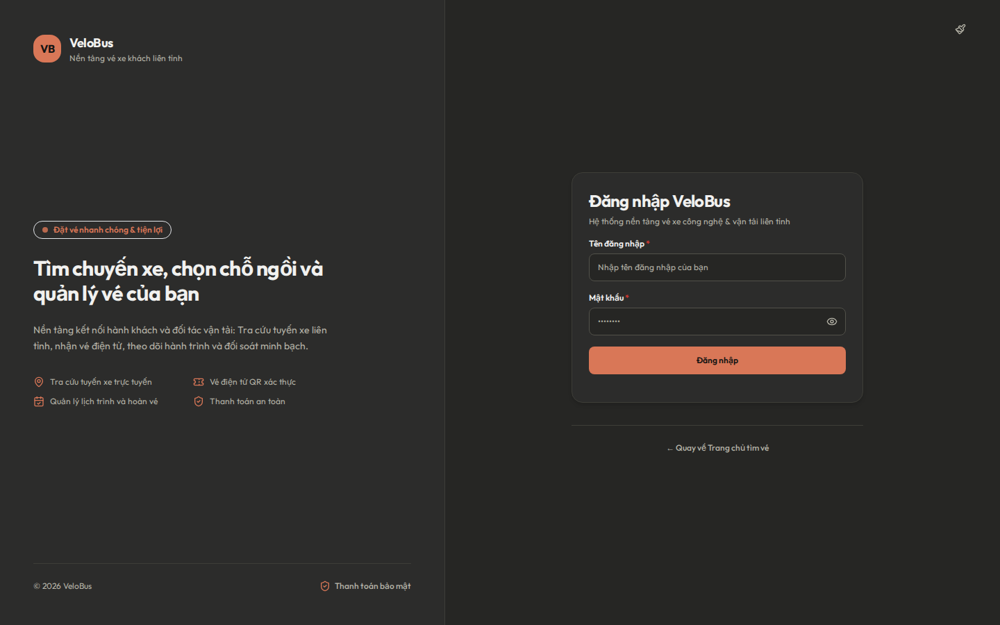 |

---

## 2. Phân Hệ Khách Hàng (Customer Booking Journey)
### 2.1 Trang chủ & Form Tra cứu (Home)
| Giao diện sáng (Light Mode) | Giao diện tối (Dark Mode) |
|---|---|
| 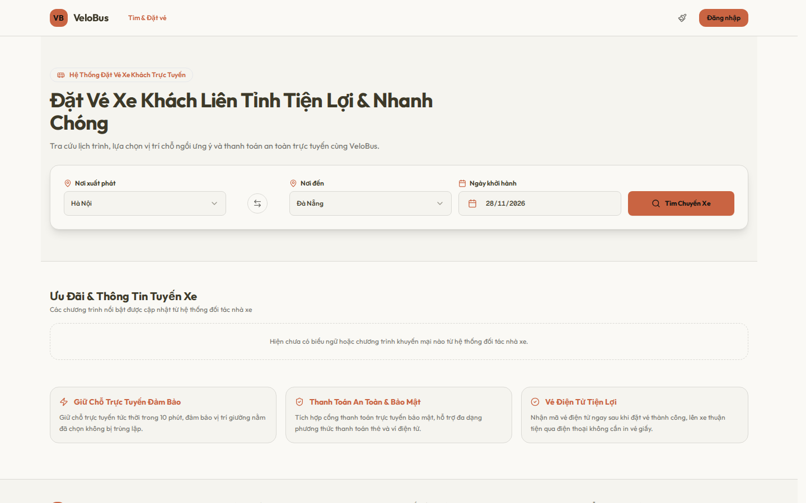 | 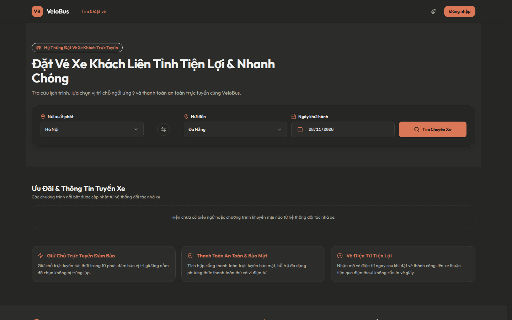 |

### 2.2 Danh sách Chuyến đi & Sơ đồ Ghế (Search & Seat Selection)
| Kết quả Tra cứu Chuyến xe | Sơ đồ Chọn Ghế 2 Tầng |
|---|---|
| 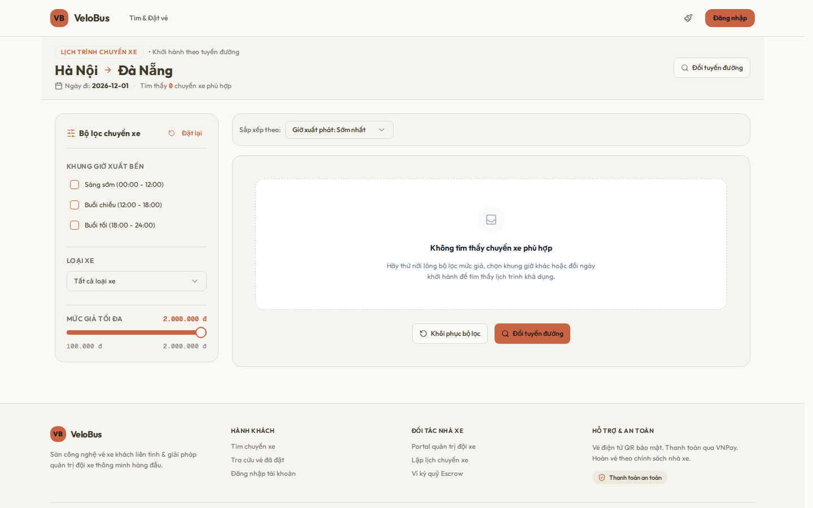 | 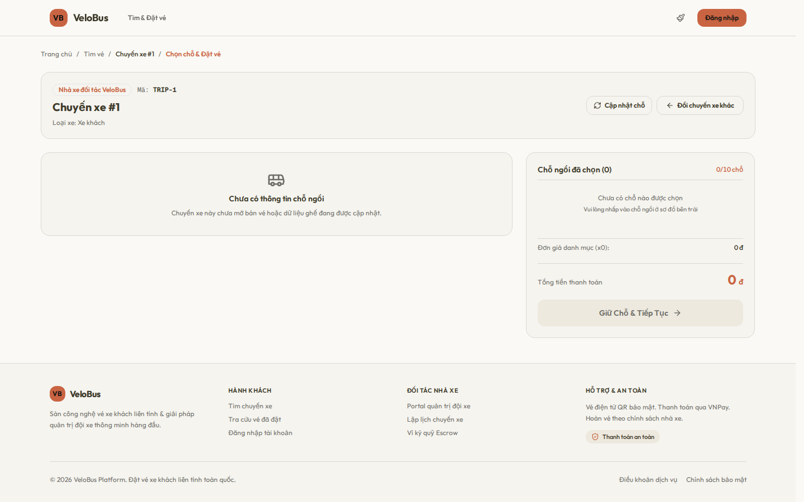 |

### 2.3 Thanh toán & Vé Điện Tử QR Code (Checkout & Bookings)
| Màn hình Checkout VNPay | Lịch sử Vé & Vé Điện Tử QR HMAC-SHA256 |
|---|---|
|  | 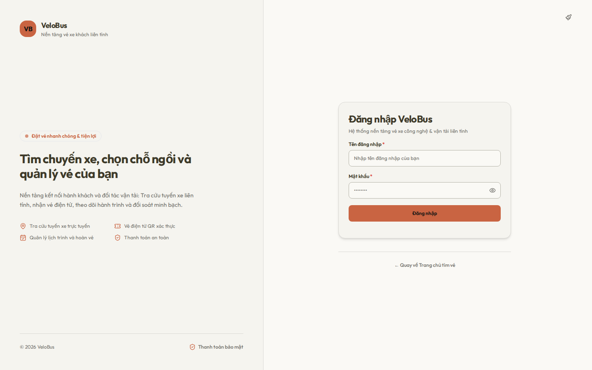 |

---

## 3. Phân Hệ Ban Quản Trị (Admin Backoffice)
### 3.1 Dashboard & Báo cáo Tài chính GMV
| Admin Dashboard (Light Mode) | Admin Dashboard (Dark Mode) |
|---|---|
| 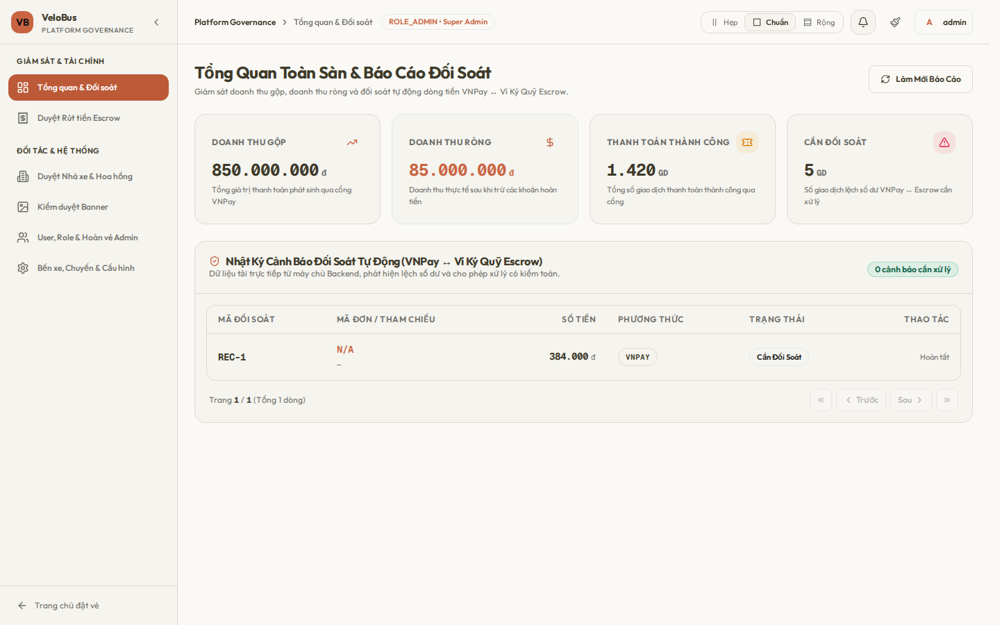 | 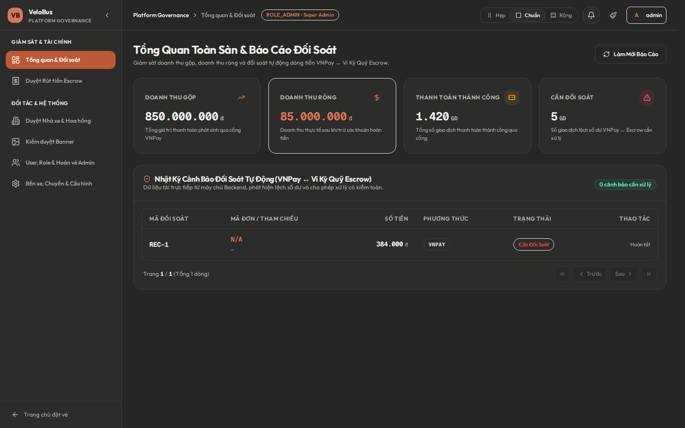 |

### 3.2 Quản lý Giải ngân Ví Escrow (Withdrawals Payout)
| Danh sách Lệnh Rút Tiền & Chốt Chặn Fail-Closed |
|---|
| 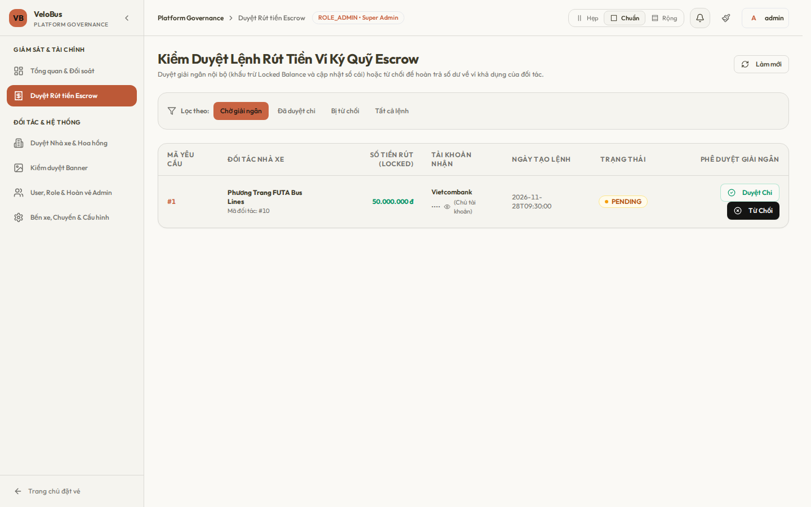 |

---

## 4. Phân Hệ Đối Tác Nhà Xe (Operator Portal)
### 4.1 Dashboard Ví Ký Quỹ & Doanh thu
| Operator Dashboard (Light Mode) | Operator Dashboard (Dark Mode) |
|---|---|
| 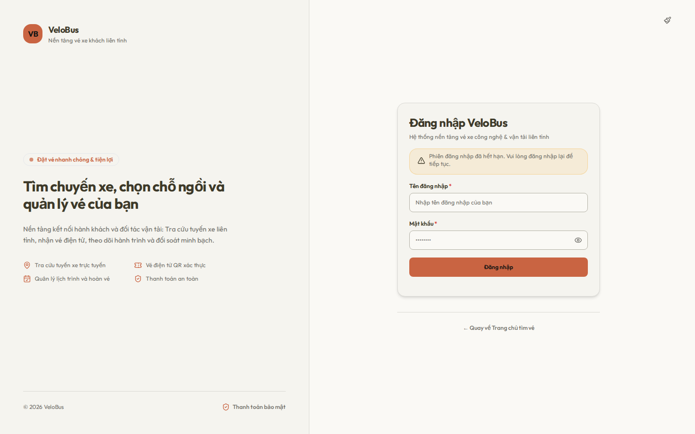 | 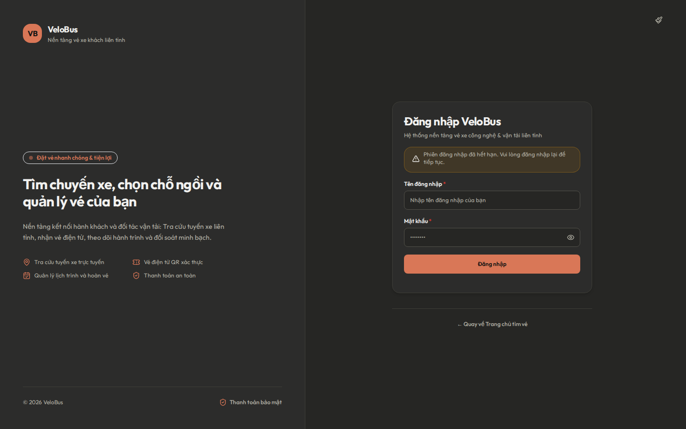 |

### 4.2 Lập Lịch Chuyến Xe & Chốt Chặn Turnaround Buffer 30 Phút
| Lập lịch Chuyến xe & Điều độ Vận hành |
|---|
|  |

---

## 5. Trải Nghiệm Thiết Bị Di Động (Mobile Responsive - 375x812)
| Trang chủ Khách hàng (Mobile) | Admin Dashboard (Mobile) |
|---|---|
| 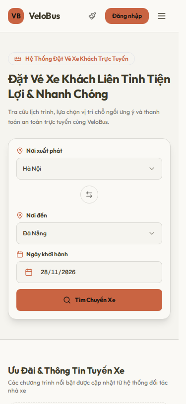 | 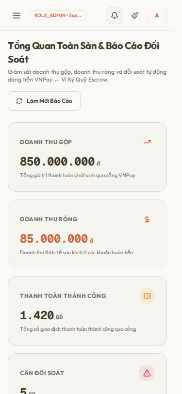 |
